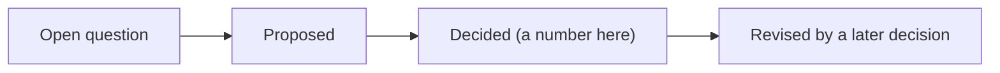

# Decisions

Every numbered design decision, and the questions still open. Rows are short on purpose: the design pages hold the detail, and git history holds each decision's original wording.

> **In one minute**
> - **Decided:** build on it. **Proposed:** confirm before relying on it. **Open:** not decided.
> - A later decision that changes an earlier one is noted on the earlier row.
> - Design choices belong to the project owner. A new decision gets the next number and a row here.

## The decisions that shape the design most

Read these first: D2, D3, D60, D61, D76, D81, D119, D136, D140, D141, D143, D146, D147, D150.

## Decision log

### Foundations (D1–D59)

| # | Decision | Status |
|---|---|---|
| D1 | Three layers: Organization → Space → Application. Stores and topics belong to Spaces. | Decided |
| D2 | Build bottom-up, search top-down. Higher layers are rollups. | Decided |
| D3 | Interfaces are nodes. Links between apps come from shared interfaces. | Decided |
| D4 | Phase order: Application → Space → Organization | Decided |
| D5 | Phase 1 is static only | Decided |
| D6 | Neo4j for the graph, Postgres for app state | Decided (Neo4j leaning) |
| D7 | Flows: triggers, no Jobs or Subflows, ordered steps, linked and never nested | Decided |
| D8 | One database with architecture and code nodes, with functions as code nodes | Decided; revised by D60 |
| D9 | One repository → many Applications | Decided |
| D10 | Incremental updates on merge | Superseded by D59 |
| D11 | Steno owns re-ingestion. Attribution comes from the Projects pillar, which never supplies structural facts. | Decided; reworded by D145 |
| D12 | Jev for all decisions rules can't make | Decided; deferred to `v2` by D94 |
| D13 | Steno's own symbol resolution, cloning into temporary workspaces. No SCIP. | Decided; refined by D69 |
| D14 | Routing: classify with Jev, then search one scope or fan out | Decided; in the POC by D142; revised by D150 |
| D15 | Schemas later; record entity → table and table-level access now | Decided |
| D16 | Labels for abstraction, no `IS_A` edges | Decided |
| D17 | No stored file contents | Decided |
| D18 | `fact_change` keeps before and after | Decided; traces per flow by D60 |
| D19 | The MCP tool set | Decided |
| D20 | Edge names: `INVOKES`, `CALLS`, `STARTS`, `LEADS_TO` | Decided |
| D21 | Jev navigates at query time (Q0, Q1, Q2, Q3, Q4) | Decided; `v2` with Jev (D94); parts in the POC by D142, D150 |
| D22 | Find flows with vector, keyword, and glossary, with a global search alongside routing. Entity anchors deferred. | Decided; refined by D150 |
| D23 | Embeddings live in Neo4j | Decided; refined by D150 |
| D24 | Every flow gets an LLM purpose and narrative | Decided; revised by D143 |
| D25 | Rule packs, auto-enabled, with a coverage report | Decided; revised by D120 |
| D26 | Measure first: a no-LLM dry run and a cost projection | Decided |
| D27 | Spaces are defined by admins | Decided |
| D28 | Glossary is human-declared for now | Decided; reworded by D145 |
| D29 | Citations in every MCP result | Decided |
| D30 | A connector is a system + scope; explicit list, then discovery | Decided; revised by D77 |
| D31 | Flow levels L0–L3 with a rendered card | Decided; revised by D60, D143 |
| D32 | Business context from the Projects pillar (`Project -CHANGED-> element`) | Decided (`v1`); reworded by D145 |
| D33 | Postgres: told and did. Neo4j: knows. | Decided |
| D34 | One deployment per organization | Decided |
| D35 | The queue is `ingestion_job` (`SKIP LOCKED`) | Decided |
| D36 | Neo4j is rebuildable from Postgres + git, without new LLM spend | Decided |
| D37 | The organization is one Postgres row, projected into Neo4j | Decided |
| D38 | First-run onboarding: Organization → Spaces → Connectors → Repositories | Decided |
| D39 | Access, selection, and placement are separate. Placement rules at scale. | Decided |
| D40 | Rule format: ast-grep `match`, Steno `emit`, `where` on types; rules meet through clues | Decided |
| D41 | Every rule has test cases | Decided |
| D42 | A person owns every rule | Decided; revised by D120 |
| D43 | Packs grouped by ecosystem | Decided |
| D44 | Ingest Contextualized first, as test input | Decided |
| D45 | `{Function: {symbol}}` for functions referenced but not called | Decided |
| D46 | `{table_of: …}`; dropped when not a mapped entity | Decided |
| D47 | The `client` clue for SDK objects | Decided |
| D48 | `Vector` is a `DataStore` category | Decided |
| D49 | Packs enabled by dependency, import, or `always` | Decided |
| D50 | References by some identity properties: one match, `ambiguous`, or a stub | Decided |
| D51 | Python resolution is Steno's own, on `ast` | Decided |
| D52 | LLM access through LiteLLM | Decided; refined by D142, D149 |
| D53 | UI: semantic zoom; views shared with `get_node` | Decided |
| D54 | First MCP tools; every call logged | Decided |
| D55 | POC staging | Decided; refined by D94 |
| D56 | "Resolver" means only the symbol resolver. Clue combining is an assembler. | Decided |
| D57 | Parse is split from extract | Decided |
| D58 | Inherited methods follow the subclass; abstract calls link every implementation as `candidate` | Decided; bound entries by D60 |
| D59 | Nightly: full re-analysis of repositories that moved; only changes written | Decided; one-transaction write revised by D135 |

### Flows, resolution, coverage (D60–D74)

| # | Decision | Status |
|---|---|---|
| D60 | **No Function nodes.** The call graph is in memory; each flow stores its trace. | Decided; re-measured by D140 |
| D61 | **Communication is general:** sender, receiver, shared key | Decided |
| D62 | Coverage is aggregated org-wide; triage persists | Decided; refined by D121, D146 |
| D63 | Traces live on the `Flow`, compressed; every first-party function, once per call site | Decided; re-measured by D140 |
| D64 | HTTP calls are never merged into one unknown target; paths never name a service | Decided |
| D65 | Coverage's first version | Decided; refined by D146 |
| D66 | `client` clues may declare `extends` | Decided |
| D67 | Coverage reads by scope | Decided |
| D68 | `get_flow` returns an outline | Decided |
| D69 | Java starts from source and the JDK; JARs later; one pass, then looked up | Decided |
| D70 | One resolver per language, one interface; a shared property map | Decided |
| D71 | **Gaps are visible, never silent** | Decided |
| D72 | The Java resolver supplies Lombok members | Decided |
| D73 | Declarative clients get `CALLS` on the method; generated ones use `client` | Decided |
| D74 | Inferred entry points for work nothing starts (confidence 0.5) | Decided |

### Boundaries, witnesses, identity, scope (D75–D98)

| # | Decision | Status |
|---|---|---|
| D75 | Only witnesses write to Steno; it isn't a system of record; passive | Decided; revised by D141 |
| D76 | **Witness types,** decided by what consumes the information | Decided |
| D77 | Anything in a repository comes through git; API connectors in `v1` | Decided |
| D78 | One system read two ways is one witness | Withdrawn by D113 |
| D79 | The facet list; every graph type is fed by a facet | Decided |
| D80 | Evidence facets compare; authority facets use a ladder | Decided |
| D81 | **Four-part identity:** Steno ID, canonical name, display name, aliases | Decided |
| D82 | The name ladder; no silent fuzzy matching | Decided |
| D83 | Identify and lifecycle: two exact lookups, tombstones | Decided |
| D84 | Manual renames, after or ahead of time | Decided |
| D85 | Application kinds are labels from triggers | Decided |
| D86 | Artifacts: A1 (the link), A2 (flows into libraries) | Decided |
| D87 | Pipeline additions: identify, reconcile | Decided (direction) |
| D88 | Facets arrive when a target needs them | Decided |
| D89 | Gaps are reported | Decided |
| D90 | Code search uses the git host's API | Decided |
| D91 | Config repositories' facts attach to what they describe | Decided |
| D92 | Frontends in `v2`, with two hooks kept | Decided |
| D93 | The onboarding flow; the UI is for onboarding and coverage first | Decided |
| D94 | Scope is POC → v1 → v2 | Decided; Jev routing pulled in by D142 |
| D95 | Every stage is measured, with and without Steno | Decided |
| D96 | Catalogs are witnesses, not competitors | Decided |
| D97 | Projects across time | Back in Steno by D141 (`v1`) |
| D98 | Scope is driven by use cases | Decided; revised by D141; reworded by D145 |

### Building the POC (D99–D114)

| # | Decision | Status |
|---|---|---|
| D99 | One job per repository, in parallel | Decided; revised by D128 |
| D100 | Unknown hosts state what's known: `config_keys`, `paths`, `possible_targets` as hints | Decided |
| D101 | **The map and its ledger:** I/O calls and hooks are explained, harmless, or a gap | Decided; refined by D136 |
| D102 | ORM effects: cascades, `@Query`, physical naming | Decided |
| D103 | Interceptors are a flow's first steps; `access` and `provides` clues | Decided; extended by D116 |
| D104 | Data stores and external systems are searchable | Decided |
| D105 | An unconfirmed connection makes an answer incomplete | Decided; revised by D118 |
| D106 | Packs declare tested versions; Steno reads versions in use | Decided |
| D107 | Environments and switches come later | Decided |
| D108 | Dependency kinds are kept apart: call, data, library, shared model | Decided |
| D109 | Claims live in a Postgres store | Decided |
| D110 | The POC's platform source is the XLD repository, through git | Decided |
| D111 | Repositories have a role: code or configuration | Decided |
| D112 | Terms: witness, witness type, claim. "Provider" means an LLM provider. | Decided |
| D113 | The XLD repository and server are separate witnesses | Decided |
| D114 | Claims and reconcile, as built | Decided |

### Depth and rule curation (D115–D135)

| # | Decision | Status |
|---|---|---|
| D115 | Contracts per usage | Decided (stage B); narrowed by D137 |
| D116 | Interceptors are nodes, with `ACTIVATES` and `INTERCEPTED_BY` | Decided (stage B); narrowed by D138 |
| D117 | `get_interface` returns what's needed to call an interface | Decided (stage B); revised by D137 |
| D118 | Completeness says what was checked, never "complete" | Decided (stage A) |
| D119 | **Breadth and depth.** Steno never runs an agent; answers carry `sources`. | Decided (`POC`); refined by D136 |
| D120 | **An LLM drafts rules, never facts** | Decided (`POC`); revised by D147 |
| D121 | Patterns: fingerprints, occurrence keys, states | Decided (`POC`); revised by D147 |
| D122 | Rank, don't exclude; core noise lists | Decided (`POC`); refined by D139, D146 |
| D123 | Frameworks are packs; patterns cluster by owner | Decided (`POC`); revised by D129, D147 |
| D124 | Drafter backends | Decided (`POC`); revised by D147 |
| D125 | Approved rules committed by Steno | Decided (`POC`); revised by D147 |
| D126 | Rule health | Decided (`POC`); not built |
| D127 | **Java scales by splitting:** two passes, disk output, module isolation | Decided (`POC`) |
| D128 | Ingestion fits the machine | Decided (`POC`; built); revised by D134 |
| D129 | Rules go where their library comes from | Decided (`POC`) |
| D130 | The Claude Agent SDK drafts rules | Decided (`POC`; built); revised by D147 |
| D131 | Rules published as one pull request per destination | Decided (`POC`; built); revised by D147 |
| D132 | Gateways expose routes; routes forward to applications | Decided (2026-10-28) |
| D133 | A client-side investigation plugin | Decided (stage A); not built |
| D134 | Jobs fit the memory free now | Proposed (`POC`; built) |
| D135 | A repository's graph is written in many small transactions | Proposed (`POC`; built) |

### The breadth line, routing, and rule authoring (D136–D150)

| # | Decision | Status |
|---|---|---|
| D136 | **Compute deep, store the surface, point to the body.** Five stored layers. | Decided (`POC`) |
| D137 | Contracts are field lists and pointers | Decided (stage B) |
| D138 | Interceptors: who turns them on, not what they require | Decided (stage B) |
| D139 | A rule names its facet and use-case question | Decided (`POC`) |
| D140 | **Stage A measures routing accuracy, and whether traces beat reach.** Function-to-flow lookup stays. | Decided (stage A) |
| D141 | **Steno becomes the context layer:** Architecture, Projects, Constraints | Decided (direction); design `v1` |
| D142 | Jev routes questions in the POC, behind a stand-in, with a `routing` block | Decided (stage A); revised by D150 |
| D143 | **Summaries for applications and above; deterministic digests for flows** | Decided (stage A); lazy purposes Proposed; revised for routing by D150 |
| D144 | Routing and scale are tested at our organization, not a mock | Decided |
| D145 | Steno is separate from Contextualized | Decided |
| D146 | **Coverage reports gaps on the surface,** connections first | Decided (`POC`) |
| D147 | **Rules are drafted locally by the skill.** Steno finds and checks. | Decided (`POC`) |
| D148 | Items follow their pull requests; org-only mode | Decided (`POC`) |
| D149 | The LLM is what the organization selects, through LiteLLM (pinned) | Decided (`POC`) |
| D150 | **Routing goes flows first.** Links state their certainty. Semantic search is optional, with a local model. | Decided |

## Open questions

**Flows and scale**
- [ ] **Why an organization's run took 8+ hours in the flows stage.** The cause is unknown, because a stopped stage recorded nothing. `fix/flows-scale` adds progress logs and fixes found on ThingsBoard ([Large repositories §3c](../how-it-works/ingestion/large-repositories.md#3c-flows-work-done-once)).
- [ ] **How deep flows go (D60, D63, D140).** Full traces and Steps against reach alone.
- [ ] **What's still proportional to a repository on the write path (D135).** The comparison reads every node's properties; a hash per node could bound it. Traces are 59% of properties.
- [ ] Flows per application in a monorepo (D127).
- [ ] Eclipse JDT, if the helper fails a larger benchmark (D127).
- [ ] The fan-in threshold for `utility` (3 today).

**Plan and scope**
- [ ] **Roadmap order.** Whether stages B and C are cut, so the trial at our organization comes sooner (D144).
- [ ] Jev credits, and its calibration on our questions (D142).
- [ ] Routing design's open points ([§8](./routing-design.md#8-questions-to-settle)).

**Environments and values**
- [ ] **Environments.** One logical node, with per-environment bindings. How joins use them is open.
- [ ] What the XLD repository looks like: needed for its pack.
- [ ] Values an admin declares when a repository can't supply them (ADMIN, never a secret).

**What Steno can state**
- [ ] Commands and tools as ways in (`CliCommand`, `McpTool`).
- [ ] Local files as stores.
- [ ] Whether a graph query reads or writes.
- [ ] Shared keys for caches and object stores.
- [ ] Change data capture: a table becoming a topic.
- [ ] What a schema means (Data V2, [#8](https://github.com/KBavis/steno/issues/8)).
- [ ] Confidence levels, so an inferred fact never looks deterministic.
- [ ] Naming the service behind an unknown host.

**Libraries**
- [ ] Artifacts A2: how a trace continues into a library in another repository.
- [ ] Finding an internal library's repository without A1.
- [ ] Java dependencies, in order: public JARs, internal source, then a private repository.
- [ ] How resolution scales to more languages.
- [ ] A representative organization Java repository to measure against.
- [ ] The signals marking a Service module and `plugins/` libraries.

**Rules and coverage**
- [ ] Re-ingesting when a pack changes.
- [ ] A dedicated rules repository, and contributing rules back (D129, D131).
- [ ] Occurrence history across renames (D121).
- [ ] Marking in-process libraries as noise without a person.
- [ ] The setup sheet's format, and witness classification edge cases.
- [ ] Glossary format.

**Client deployment (`v1`)**
- [ ] Where Steno runs. MCP authentication and scoping. Data policy. Embeddings model. The LLM for summaries. Cost budget. Neo4j edition and licensing. Who builds a client's question set.

**The context layer (`v1`, D141)**
- [ ] How Projects and Constraints fit witnesses and claims.
- [ ] Mapping a PR's lines to the graph at its merge commit.
- [ ] The onboarding question set.
- [ ] Library versions per environment.
- [ ] What stands in for Jira's top-level ticket elsewhere.
- [ ] How pillars are laid out in code and named in MCP.

**`v2`**
- [ ] Scripts as entry points (D74).
- [ ] Jev calibration.
