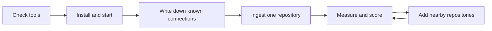

# First run at an organization

A step-by-step guide to trying Steno on real repositories, on a Windows laptop with WSL and without `uv`. Part of [Plan](./README.md).

> **In one minute**
> - Ingest one repository first, then a few nearby. Measure time, memory, and disk as you go.
> - **No LLM or Jev is needed.** A `dry_run` job builds a real graph and skips LLM text, so no code or code-derived text leaves the laptop. Only the git host sees a clone.
> - Before looking at any results, write down connections you know exist. Scoring those is the point of this run.
> - Keep anything about your organization out of Steno's repository: its rules go in a separate pack repository.



---

## 1. Before you start

**Check your organization's rules first:** whether you may run a personal open-source project on a work machine, and whether Docker is allowed. Steno's repository is public and has no license file yet.

Everything runs in **WSL**, with folders in your Linux home (`~/`), not under `/mnt/c`, which is much slower.

```sh
python3 --version          # 3.12 or newer
java -version              # 21 (Gradle looks for a JDK 21)
docker compose version     # Docker in WSL, or Docker Desktop with WSL integration
git --version
free -g; df -h ~           # memory and disk WSL has
```

| If this is missing | Then |
|---|---|
| Python 3.12 | Install it from your organization's approved source. Steno needs 3.12 or newer |
| Java 21 | Install a JDK 21, or `resolver-jvm` won't build and Java repositories can't be read |
| Docker | Stop here and work out an approved way to run Neo4j and Postgres |
| Memory | WSL takes half the machine by default. Raise it in `%UserProfile%\.wslconfig` if you need to (`memory=12GB`), then `wsl --shutdown` |

**Plan on:** at least 8 GB of memory for a large repository, and at least 10 GB of free disk for tools plus the first graph. These are starting estimates. This run measures the real numbers.

## 2. Get Steno

A public repository needs no credentials to clone.

```sh
cd ~
git clone https://github.com/KBavis/steno.git
cd steno

# Make pushing from this machine impossible
git remote set-url --push origin no_push
```

To get updates later: `git pull`, then rebuild the helper (step 4).

**Your git identity only matters when you commit.** Cloning records nothing about you. Don't commit in this clone. Your organization's rules go in their own repository (section 8).

## 3. Install without `uv`

The `Makefile` runs its commands through `uv`, so this guide calls `steno` directly. Run every `steno` command from `backend/`, because that's where it reads `.env` from.

```sh
cd ~/steno/backend
python3 -m venv .venv
source .venv/bin/activate
pip install -e .
steno --help
```

Run `source ~/steno/backend/.venv/bin/activate` in each new terminal.

**Behind a proxy or package mirror:**

```sh
pip config set global.index-url https://<your-mirror>/simple
export HTTPS_PROXY=http://<your-proxy>:<port>
```

Then create the settings file:

```sh
cp ../.env.example .env
```

Add these lines to `backend/.env`:

```sh
STENO_SUMMARIES_ENABLED=false
STENO_DECISION_BACKEND=stand_in
```

## 4. Start the services

```sh
cd ~/steno
docker compose -f deploy/docker-compose.yml up -d --wait

# Build the Java helper
cd resolver-jvm && ./gradlew installDist && cd ..

cd backend
steno db upgrade
steno graph init
steno rules list
```

**If Gradle can't download:** it fetches itself from `services.gradle.org` and libraries from Maven Central. Point it at your mirror or proxy in `~/.gradle/gradle.properties` (`systemProp.https.proxyHost`, `systemProp.https.proxyPort`), or ask how your organization's builds reach them.

**If images won't pull:** you need `neo4j:2026.09-community` and `postgres:18-alpine`, possibly through your organization's registry. Change the names in `deploy/docker-compose.yml` locally if so.

In two more terminals, each with the virtual environment active and the token from section 5 exported:

```sh
cd ~/steno/backend && steno api      # the Admin API on :8000, and MCP on :8000/mcp
cd ~/steno/backend && steno worker   # runs ingestion jobs
```

## 5. Connect your git host

Create an HTTP access token that can **read** repositories, then export it in the terminals running `steno api` and `steno worker`. Steno stores only the variable's name.

```sh
export GIT_TOKEN=<your-read-only-token>
```

```sh
API=http://localhost:8000/api

curl -s -X POST $API/connectors -H 'Content-Type: application/json' -d '{
  "name": "bitbucket",
  "kind": "bitbucket",
  "base_url": "https://<your-bitbucket-host>",
  "credentials_ref": "env:GIT_TOKEN"
}'

curl -s -X POST $API/spaces -H 'Content-Type: application/json' -d '{
  "name": "<a division, such as a line of business>"
}'

curl -s -X POST $API/repositories -H 'Content-Type: application/json' -d '{
  "connector_id": 1,
  "space_id": 1,
  "name": "<repository-name>",
  "clone_url": "https://<your-bitbucket-host>/scm/<PROJECT>/<repo>.git",
  "default_branch": "<its default branch>"
}'
```

Use the IDs each answer returns. For `kind`, use `bitbucket`, `github`, or `gitlab`.

**If the clone fails on authentication:** Bitbucket on your own servers hasn't been tried against a real server. Use an SSH `clone_url` with your SSH key instead, and leave `credentials_ref` out. Code tools read files through the host's API, so they still need a token.

## 6. Write down what you already know

**Do this before you ingest.** Otherwise you'll grade Steno by what it found. List about 10 connections you're sure of, in a private file outside Steno:

| # | From (application, operation) | To (application, operation or topic) | Kind | Crosses a space? | Result |
|---|---|---|---|---|---|
| 1 | | | HTTP | | |
| 2 | | | Kafka | | |

Include both HTTP and messaging, at least one that crosses into another space, and one you expect to be hard.

## 7. Ingest and measure

**Start with one repository.**

```sh
cd ~/steno/backend
df -h ~ > ~/steno-disk-before.txt
docker exec steno-neo4j-1 du -sh /data >> ~/steno-disk-before.txt

steno job enqueue <repository-name> --mode dry_run

# In another terminal, while it runs
watch -n 5 'free -h; docker stats --no-stream; du -sh /tmp/steno-workspaces'
```

Then record:

```sh
curl -s http://localhost:8000/api/jobs | python3 -m json.tool | head -60
steno graph stats
docker exec steno-neo4j-1 du -sh /data
docker exec steno-postgres-1 sh -c 'du -sh "$PGDATA"'
```

| Measure | One repository | With nearby repositories |
|---|---|---|
| Java files | | |
| Time to ingest | | |
| Peak memory | | |
| Neo4j on disk | | |
| Postgres on disk | | |
| Flows and nodes | | |

**Read the results:**

```sh
steno coverage patterns --limit 30
steno coverage show <fingerprint>
```

For questions, connect a client to `http://localhost:8000/mcp`, or call the API. The web UI is optional, and needs Node 20 (`cd ~/steno/frontend && npm install && npm run dev`).

**Score your list.** For each connection:

- **Linked:** Steno found it, correctly.
- **Reported as a gap:** missed, but it says so on the coverage report.
- **Silently missed or wrong:** the result that matters most. Write down what the code looks like, sanitized.

Then add 2–3 nearby repositories, including one from another space, and repeat. **Links between repositories over HTTP aren't built yet,** so expect those as gaps for now. Topics join across repositories by name.

**What the result means:**

| Most of your connections are | Then |
|---|---|
| Linked | Keep going: more repositories, then the question set |
| Gaps a rule or deployment data can fill | Write rules (section 8), and add the missing sources |
| Gaps nothing in the repositories can fill | Narrow what Steno promises, or bring in runtime data |
| Silently missed | Stop and look at why. Steno must never miss silently |

## 8. Your organization's rules

Keep them in their own repository, outside Steno. You can start with a local one, and add a remote on your organization's git host when you're ready.

```sh
mkdir -p ~/steno-org-rule-pack && cd ~/steno-org-rule-pack && git init

# Your organization's identity, for this repository only
git config user.name "<your name>"
git config user.email "<your work email>"
```

Add these to `backend/.env`:

```sh
STENO_RULE_PACK_DIRS=/home/<you>/steno-org-rule-pack
STENO_RULES_ORG_ONLY=true
```

These last two arrive with PR #28 (D148), so `git pull` once it merges. With `STENO_RULES_ORG_ONLY=true`, every rule goes to this repository and nothing is committed to Steno. When a rule is about a public framework, the skill lists it as a generic miss, with no organization code, for someone to bring back to Steno. `steno rules destinations` prints where rules will go.

**What goes where:**

| It describes | Goes in |
|---|---|
| Your organization's file formats, naming, or internal libraries | The pack repository |
| A public framework | For now, the pack repository or the generic-miss list. It moves to Steno's core packs later, rewritten with synthetic code |

**Writing rules:** use the `rule-pack-author` skill in `.claude/skills/`. GitHub documents that Copilot CLI reads this folder, but we haven't tried it.

## 9. Don't send this to Steno's repository

- Your organization's code, names, or configuration, including in test cases.
- Scores or notes from this run, unless they're sanitized.
- Tokens: `backend/.env` is ignored by git, so keep them there or in your shell.

## 10. Later, when approved

These send code-derived text (names, docstrings, digests) out of the laptop, so confirm your organization's policy first:

- **LLM summaries:** a `full` job with a provider, through your organization's gateway.
- **Jev:** routing with real judgments.

The first run doesn't need either.
