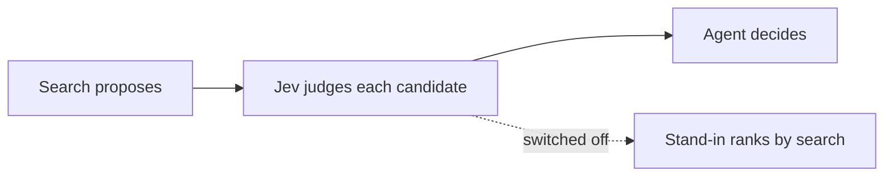

# Jev: Decisions

How Steno uses [Jev](https://typesafe.ai/blog/introducing-system-one-models-and-jev), a decision model that answers typed questions with probabilities.

> **In one minute**
> - **Built, optional, query time (D142, D150):** Q0, Q4, and N4 in routing. The stand-in is the default. Q1 and Q2 no longer run.
> - **Ingestion decisions and the rest of navigation:** `v2`.
> - It answers typed questions in 70–500 ms. It reads bounded digests, not raw code, and never decides alone.

## Reaching Jev (built)

`STENO_DECISION_BACKEND=jev` (`decisions/jev.py`).

| Setting | Default | Through a gateway |
|---|---|---|
| `STENO_JEV_BASE_URL` | `https://api.typesafe.ai/v1` | The gateway; Steno adds `/systemone` |
| `STENO_JEV_API_KEY_REF` | `env:JEV_API_KEY` | Any `env:NAME` |
| `STENO_JEV_AUTH_HEADER`, `STENO_JEV_AUTH_SCHEME` | `Authorization`, `Bearer` | For example `api-key`, empty |
| `STENO_JEV_MODEL` | Pinned `jev-1.14.0` | What the gateway serves |

`steno jev-check` asks one question. If Jev can't answer, search uses the stand-in and says why. Bands appear only with `STENO_JEV_CALIBRATED=true`.

**Wording matters.** "Is this flow part of what the user's question is about?" got 14 of 15 first; "Does this do what was asked?" got 10.

## 1. Why use it

Navigating an architecture is a series of uncertain choices. Jev makes each one typed, gives a probability, and is fast and cheap ($0.042 per million input tokens).

## 2. What it is, and its limits

- **Question types:** Noul (yes/no), Choice (up to 255 options), Score (2–10 levels).
- **Input:** about 64k tokens per call. Text only.
- **Can't** generate text. **Weak at** multi-step reasoning, counting, dates, and large irrelevant state.
- New (2026-09-15), so its claims are checked on our data.

## 3. Where it fits

Rules extract facts, Jev decides what rules can't, an LLM writes text, and the client's LLM reasons. **Deterministic first.**

## 3a. Jev never decides alone

Search proposes and Jev judges. Close calls keep both branches. **Every decision can be switched off.**

## 4. What Jev sees: state design

**Digests, bounded by construction.** A flow with 800 functions gets a digest about the size of one with 8.

| Digest | Size |
|---|---|
| Flow digest | About 150 tokens on our graph, up to about 400 |
| Space or application summary line | About 30 tokens |
| Call site (`v2`) | About 150 tokens |

A batch over the limit is split and run in parallel.

## 5. Confidence bands

| Confidence | Action |
|---|---|
| **> 0.9** | Act |
| **0.5–0.9** | Act, and mark it |
| **< 0.5** | Don't decide: several options, or ask |

Starting points, to tune on logged decisions (`jev_decision`).

## 6. Decisions at query time

| # | Decision | Type | Status |
|---|---|---|---|
| **Q0** | What kind of question? | Choice | Built |
| **Q4** | Is this candidate what was asked? | One Noul per candidate | Built |
| **N4** | Which of several similar names? | Choice | Built |
| Q1, Q2 | Which spaces, which applications | | Removed by D150 |
| Q3 | Rank and trim | Score | `v2` |
| Q2b | Which entity? | Choice | Deferred |
| N1 | Beam search down the tree | Noul | `v2` |
| N2 | Guided expansion when a walk fans out | Score | `v2` |
| N3 | When to stop | Noul | `v2` |
| N5 | How much detail | Score | `v2` |

## 7. Decisions at ingestion (`v2`)

| # | Decision | Runs when |
|---|---|---|
| **I1** | Which implementation does DI inject? | Rules find several |
| **I2** | Which transport does a call use? | No rule matched |
| **I3** | Is this an entry point? | An unknown framework looks like a trigger |
| **I4** | Internal host or vendor? | Not on the known list |
| **I5** | Does a change alter a text summary? | Facts under one changed |
| **I8** | Does an unexplained call look like I/O? | No rule matched (Proposed for coverage) |
| **I9** | What does this flow do, and to what? | Deferred |
| **I10** | Business flow or plumbing? | Every flow |

## 8. Risks and mitigations

| Risk | Mitigation |
|---|---|
| New vendor, unproven claims | Log every decision; measure before trusting thresholds |
| Weak with irrelevant state | One bounded candidate per question |
| Data policy | Confirm first. Digests hold names and summaries, rarely code. |
| Lock-in | A small `Decision` interface |
