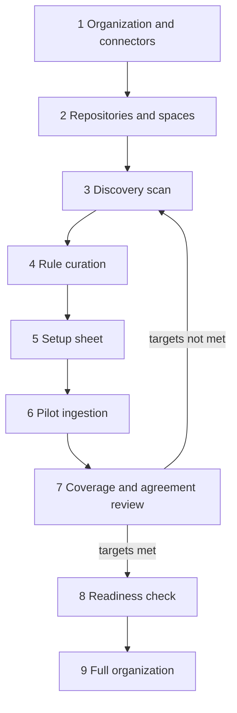

# Onboarding an organization

From first login to accurate answers over MCP. Decided (D93).

> **In one minute**
> - Nine steps, and steps 3 to 7 repeat until targets are met.
> - **Nothing is required of an organization's repositories.**
> - **The UI's main job is onboarding and coverage review.**

## The steps

| # | Step | What happens | Scope |
|---|---|---|---|
| 1 | **Organization and connectors** | Name, git hosts, credential references | `POC` (git); `v1` (others) |
| 2 | **Repositories and spaces** | Declare spaces, select and place repositories | `POC` (by hand); `v1` (discovery) |
| 3 | **Discovery scan** | Languages, frameworks, descriptors, which packs turn on, facets with no source | `POC` (basic) |
| 4 | **Rule curation** | A developer runs the `rule-pack-author` skill, and a person approves pull requests (D147) | `POC` |
| 5 | **Setup sheet** | Witnesses per facet, ladder order, naming patterns. What to ask: [Organization standards](./organization-standards.md). | `POC` (a file); `v1` (UI) |
| 6 | **Pilot ingestion** | One representative space | `POC` |
| 7 | **Coverage and agreement review** | Each item fixed or triaged; triage persists | `POC`; `v1` (guided) |
| 8 | **Readiness check** | The organization's question set over MCP | `POC` |
| 9 | **Full organization** | Every repository, nightly | `v1` |

## Principles

- **Passive** (D75).
- **Deterministic first.** Nothing an LLM drafts runs without tests, a check, and approval.
- **The coverage report drives the work.**
- **Measure time to value.**

## Levels of involvement

| Level | The organization | Scope |
|---|---|---|
| **Passive** (default) | Grants read access | `POC` |
| **Connect** | Grants API access to other systems | `v1` |
| **Annotate** | Enters overrides and aliases | `POC`; `v1` (UI) |
| **Instrument** | Exposes traces or logs | `v2` |

## What the UI is for

| Priority | Area | Status |
|---|---|---|
| 1 | Onboarding, coverage, Settings | Built |
| 1 | Agreement view, unmatched names, identity conflicts | Planned |
| 1 | Setup sheet, guided review | `v1` |
| 2 | Jobs and runs | Built |
| 3 | Visualize (D53) | Built |

Rule review happens on pull requests, not in Steno's UI.
