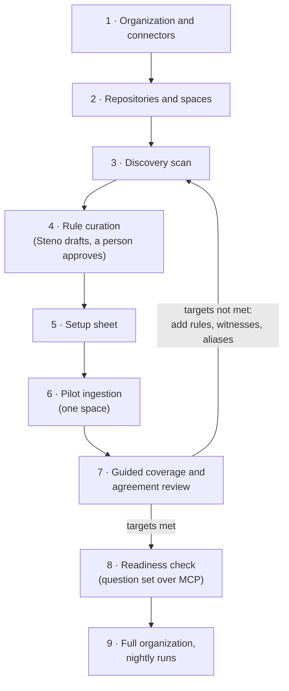

# Onboarding an organization

The flow every organization goes through, from first login to accurate answers over MCP. Part of [Plan](./README.md). Decided (D93).

> **In one minute**
> - Nine steps: organization and connectors → repositories and spaces → discovery scan → rule curation → setup sheet → pilot ingestion → guided coverage and agreement review → readiness check → full organization.
> - Steps 3 to 7 repeat until the organization meets its targets. The coverage report says exactly what to fix next.
> - **Nothing is required of the organization's repositories.** Steno reads what exists, including catalogs like Backstage or Cortex where they're already in use.
> - **The UI's main job is onboarding and coverage review.** Visualization is a later enhancement. The bar is accurate MCP answers.

---

## The steps

| # | Step | What happens | Produces | Scope |
|---|---|---|---|---|
| 1 | **Organization and connectors** | Name and description; git hosts with credentials references; later, systems reached through an API (deploy tools, artifact repositories, schedulers, catalogs) | `organization`, `connector` rows | `POC` (git); `v1` (others) |
| 2 | **Repositories and spaces** | Declare spaces (how the organization divides itself); select repositories and place each in a space. At scale: discovery plus placement rules (Bitbucket project → space) | `space`, `repository` rows; the Structure facet | `POC` (by hand); `v1` (discovery, rules) |
| 3 | **Discovery scan** | A quick, deterministic scan before ingestion: languages, build tools, frameworks found in dependencies, existing descriptors (`component_manifest.yaml`, `catalog-info.yaml`, OpenAPI, Helm, CronJobs, gateway configs), config repositories, which shared packs will turn on, and which facets have no source yet | A discovery report | `POC` (basic) |
| 4 | **Rule curation** | The first curation run (v0) over the discovery scan's patterns: "`acme-messaging` is used by 60 repositories and looks like a messaging framework; here are its sender and receiver rules, proven on all 60." A person approves a budget first, then each framework and rule ([rule curation](../how-it-works/ingestion/rule-curation.md)). **Every rule ships with tests; the LLM drafts, it never decides facts.** Witness mappings ("map `component_manifest.yaml` to Components?") are drafted the same way in `v1`. | Rules in the organization's pack repository | `POC` (D120); witness mappings `v1` |
| 5 | **Setup sheet** | Confirm, for each facet, its witnesses and their witness types, the name-ladder order, and naming patterns ("deploy name = `org-svc-{module}`"). Existing catalogs are connected here as DECLARED witnesses. | The organization's setup | `POC` (a file in the org pack); `v1` (UI) |
| 6 | **Pilot ingestion** | One representative space, not the whole organization | A graph for that space | `POC` |
| 7 | **Guided coverage and agreement review** | Walk through every item, with what it means and how to fix it: unknown hosts (declare the service), unexplained calls and libraries with no pack (approve a curated rule, or write one), unknown triggers (name the trigger), unmatched names (add an alias), disagreements (fix a rule or a stale declaration), identity conflicts and possible renames (link or separate). Ignore what's noise; triage persists. | Rules in the org pack, aliases, overrides; a shrinking open count | `POC` (the Coverage page); `v1` (guided) |
| 8 | **Readiness check** | The organization supplies a question set; Steno answers it through MCP. Targets: question accuracy, join rate, open coverage items, unknown triggers. | A readiness report | `POC` |
| 9 | **Full organization, nightly runs** | Expand to every repository; nightly runs keep it current; curation drafts rules only for patterns the organization hasn't seen before | The organization's graph | `v1` |

## Principles

- **Passive.** Steno never asks an organization to change its repositories or adopt a descriptor format. It reads what's there (D75).
- **Deterministic first.** An LLM drafts rules; the rules then run deterministically. Nothing an LLM drafts reaches the graph without passing its tests, a shadow run, and a person's approval (D120).
- **The coverage report drives the work.** Items are ranked by how many applications one fix helps, so the first few rules for an in-house framework clear most of the gaps.
- **Measure time to value:** the days until a client's join rate and question accuracy reach their targets. Every organization onboarded adds to the shared packs, so the next one needs less.

## Levels of involvement

| Level | What the organization does | What Steno gets | Scope |
|---|---|---|---|
| **Passive** (default) | Grants read access | Repositories, config, deploy definitions, manifests already in git | `POC` |
| **Connect** (optional) | Grants read access to systems reached through an API: deploy tools, artifact repositories, schedulers, catalogs | PLATFORM and DECLARED witnesses beyond git | `v1` |
| **Annotate** (optional) | Admins enter overrides, aliases, and renames in Steno (or, where a team prefers, a small `steno.yaml` in a repository) | Corrections where rules get something wrong | `POC` (Steno), `v1` (UI) |
| **Instrument** (optional) | Exposes OpenTelemetry or logs | OBSERVED: runtime-confirmed edges | `v2` |

## What the UI is for

| Priority | UI area | Status |
|---|---|---|
| **1** | Onboarding: organization, spaces, connectors, repositories | Built |
| **1** | Coverage report and triage | Built |
| **1** | Agreement view, unmatched names, identity conflicts and renames | Planned (`POC` stages B–D) |
| **1** | Rule proposals: review by framework and impact, approve, reject, revise | `POC` (D120) |
| **1** | Setup sheet; guided review | `v1` |
| 2 | Jobs and runs | Built |
| 3 | Visualize (semantic zoom from organization to code, D53) | Built; enhancements later |

## Our organization (POC stage D)

Onboarding steps 1–8 run on our own organization as a dry run: connectors for Bitbucket; the application's space; a discovery scan; `component_manifest.yaml` and the XLD repository as witnesses; the Spring and Kafka packs plus an org pack for in-house frameworks; a pilot ingestion; the coverage and agreement review; and a question set written by the team.
