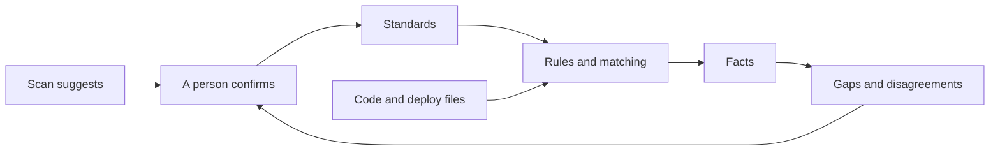

# Organization standards

What Steno must learn about an organization's conventions. **Proposed, nothing here is Decided.** Scope: `POC` as a file in the organization's pack; `v1` as onboarding questions in Constraints.

> **In one minute**
> - The engine stays general; each organization states its standards as data.
> - **A standard says where to look. It never creates a fact.**
> - **Standards can be wrong.** Where one disagrees with code, Steno reports it, and neither silently wins.
> - A discovery scan suggests answers, and a person confirms them.

## 1. The standards

| Standard | The question | What Steno does with it |
|---|---|---|
| **Component declaration** | Is there a file describing each application? | Reads it as DECLARED |
| **Unique application ID** | What ID is already used? | Exact identity, beside the Steno ID |
| **Naming convention** | How are deployed names formed? | Exact name matching |
| **Service address** | How does a service refer to another? | Reads the name from the host, never a config key |
| **Config location** | Where is runtime config? | Finds values and layers |
| **Values set outside** | Where do placeholders get values? | A PLATFORM witness, or reported as runtime |
| **Environments** | Which exist, under what names? | One node with values per environment |
| **Deployment variants** | One service deployed several ways? | One application, several deployments |
| **Repository layout** | One per service, or many in one? | Finds application boundaries |
| **Divisions** | How does the organization divide? | Spaces |
| **Internal frameworks** | Which libraries hide calls? | Rules in its pack |
| **Messaging** | How are topics declared? | Which rules apply |
| **Consumer declarations** | Does a service state who may call it? | A witness to compare |
| **Dependency declarations** | Does anything list dependencies? | A witness to compare |
| **Vocabulary** | Which abbreviations are used? | Matching words to names |

## 2. How much to trust each source

| Kind | Used for | If wrong or missing |
|---|---|---|
| **Code and its config** | Creating links | A coverage gap |
| **Deployment data** | Creating links, per environment | A coverage gap |
| **What people maintain** | Identity; a second opinion | A disagreement, never a removed link |
| **A stated standard** | Reading the other three | Listed, never forced |

## 3. Where each standard lives

| Lives in | What | Scope |
|---|---|---|
| **Core packs** | Public frameworks | Every organization |
| **The organization's pack** | Its formats and frameworks | One organization |
| **The setup sheet** | Answers to §1 | `POC` |
| **Constraints** | The same answers, attached to scopes | `v1` |

**The test:** would another organization on the same public framework want it? Yes: core. Nothing in core may name an organization.

## 4. Onboarding a new organization

Scan, confirm, pilot, improve. **Measure:** list known connections first, then count linked, reported as gaps, and silently missed. Silent misses matter most.

## 5. Not settled

The setup sheet's format; what a scan reliably suggests; how a naming pattern is written; how an external ID sits beside the Steno ID.
