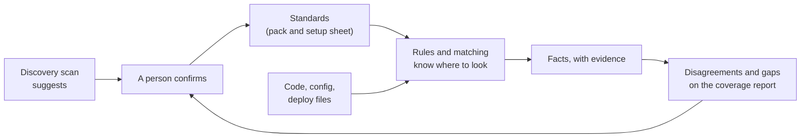

# Organization standards

What Steno must learn about any organization's conventions, and how each one helps it read the code. Part of [Plan](./README.md).

**Status: Proposed, nothing here is Decided.** Scope: `POC` as a file in the organization's pack (the setup sheet in [onboarding](./onboarding.md), step 5); `v1` as onboarding questions in the [Constraints pillar](../purpose/context-layer.md#4-constraints-v1).

> **In one minute**
> - Every organization has standards, but they differ: what names a service, where config lives, how one service addresses another. Steno's engine stays general, and each organization states its standards as data.
> - **A standard says where to look and how to read what's there. It never creates a fact by itself.** Facts still come from code, config, and other witnesses.
> - **Standards can be incomplete or out of date.** Where a standard and the code disagree, Steno reports it, and neither silently wins.
> - Steno should suggest these answers from a discovery scan, and a person confirms them. Steno still never asks an organization to change its repositories.

---

## 1. The standards

Each row is one question to answer for an organization. The examples are invented.

| Standard | The question | Example answer | What Steno does with it |
|---|---|---|---|
| **Component declaration** | Is there a file describing each application? | `service.yaml` at each service's root | Reads it as a DECLARED witness: names, description, team |
| **Unique application ID** | What ID does the organization already use? | `guid` in that file | Exact identity across renames and repositories, beside Steno's own ID |
| **Naming convention** | How are deployed names formed? | `{division}-{tier}-{service}` | Exact name matching, with the varying parts named |
| **Service address** | How does a service refer to another in config or code? | `http://{name}.{namespace}.svc.cluster.local:8080`; a gateway; a registry name | Reads the service's name from the host, never from a config key |
| **Config location** | Where is runtime config, and how does it layer? | `src/main/config/` with a folder per environment | Finds values, and notes which override which |
| **Values set outside the repository** | Where do placeholders get their values? | A deploy repository's dictionaries | Adds that source as a PLATFORM witness, or reports the value as set at runtime |
| **Environments** | Which exist, and what is each called in each source? | `dev`, `perf`, `prod`; `PROD-EU` means prod | One node with values per environment, never one node per environment |
| **Deployment variants** | Is one service deployed several ways? | One deployment per client role | One application with several deployments |
| **Repository layout** | One repository per service, or many in one? | One repository, one Gradle project per service | Finds each application's boundary |
| **Divisions** | How does the organization divide itself? | Each line of business is a space | Places applications in spaces |
| **Internal frameworks** | Which shared libraries hide calls or messaging? | A shared resilient HTTP client | Rules in the organization's pack |
| **Messaging** | How are topics declared and named? | Spring Cloud Stream; a topic registry | Which rules apply, and where a topic is declared |
| **Consumer declarations** | Does a service state who may call it? | `accepted-consumers: a, b` in config | A witness to compare with real callers. It names who, not where |
| **Dependency declarations** | Does anything list what a service depends on? | `dependencies` by ID in a manifest | A witness to compare with real calls. May be partial, such as only what tests need |
| **Vocabulary** | Which abbreviations do people use? | `clt` means client | Helps match what people say to real names |

## 2. How much to trust each kind of source

| Kind | Example | Used for | If it's wrong or missing |
|---|---|---|---|
| **Code and its config** | A client class using a configured URL | Creating links | A gap on the coverage report |
| **Deployment data** | Deploy definitions, cluster resources | Creating links, per environment | A gap on the coverage report |
| **What people maintain** | A manifest, a consumer list, a catalog | Identity and descriptions; a second opinion on links | A disagreement to look at, never a removed link |
| **A stated standard** | "Names follow this pattern" | Reading the other three | Names that don't fit are listed, never forced |

People forget to update what they maintain, so a declaration alone doesn't remove a link or prove one complete. Disagreements are where Steno finds the misses, in the code or in the file.

## 3. Where each standard lives

| Lives in | What goes there | Scope |
|---|---|---|
| **Steno's core packs** | Public frameworks: Spring, Kubernetes service names, Spring Cloud Stream | Every organization |
| **The organization's pack** | Its file formats and internal frameworks, in the organization's own repository | One organization |
| **The setup sheet** | Answers to section 1, in the organization's pack | `POC` |
| **Constraints** | The same answers as onboarding questions, attached to the organization, a space, or an application | `v1` |

**The test for what goes where:** would another organization using the same public framework want it? If yes, it goes in core. If it names this organization's files or conventions, it goes in the organization's pack. Nothing in core may name an organization.

A standard can vary inside an organization, so it attaches at a scope: an organization default, overridden for a space or an application. One team's unusual layout is a local override.

## 4. Onboarding a new organization

1. **Scan:** the discovery scan finds descriptors, naming patterns, config locations, and frameworks, then suggests answers to section 1.
2. **Confirm:** a person corrects them, and anything unanswered stays visibly unknown.
3. **Pilot:** ingest one area and read the coverage report.
4. **Improve:** each gap becomes a rule, a standard, or an accepted gap, and the answers get better with each pass.

**Measure on a pilot:** list known connections first, then count how many are linked, how many are reported as gaps, and how many are silently missed or wrong. Silent misses matter most.

## 5. Not settled

- The setup sheet's file format.
- Which answers a discovery scan can reliably suggest.
- How a naming pattern is written, and how it treats a part that varies per deployment.
- How an external ID sits beside Steno's own ID when two applications claim the same one. Proposed: flagged, never merged.
