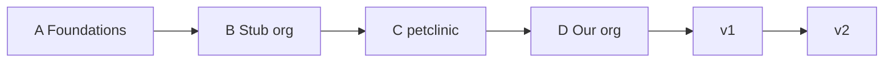

# Roadmap

The **POC** (stages A–D), **v1** (first client), and **v2** (later). Decided (D94).

> **In one minute**
> - **POC: the Architecture pillar,** proven first on one application, then on a known stub, real multi-service code, and our organization.
> - **Accuracy is the bar.** The headline score is **routing accuracy** (D140).
> - **v1** adds what a client deployment needs, plus **Projects and Constraints** (D141).
> - **v2** holds Jev at ingestion, runtime evidence, frontends, schemas, ownership, and environments.
> - **Open:** whether stages B and C stay, or D comes right after A.

## 1. Where we are

| Built | Not built |
|---|---|
| Onboarding UI, Admin API, Settings | Bulk onboarding (`v1`) |
| Job queue, nightly runs, write-only-changes, cancelable jobs | Removing a deleted repository (`v2`) |
| Identity, application kinds | Naming patterns, admin API, `:Job` |
| Claims and reconcile: Messaging, names, routes, HTTP links across repositories | Comparing schedules, topic placement, setup sheet |
| 33 packs, 90 rules, with tests and tested versions | Organization packs (XLD, `component_manifest.yaml`) |
| Python and Java resolvers, at scale | JARs, Artifacts A1 and A2, flows per application |
| Rule engine, flows, traces, steps, digests, inferred flows, interceptors as steps | Contracts, interceptor nodes |
| Coverage on the surface, patterns, `steno rules check`, the skill | Rule health, new-since-last-run |
| MCP: 6 tools, completeness, `sources`; flows-first routing; summaries; optional Jev and embeddings | `get_interface`, `analyze_change`, one-sentence purposes, connected flows in answers, the plugin |

Contextualized and budgeting-app ingest end to end. A three-repository stub proves reconcile.

## 2. POC stages

| Stage | Scope | Done when |
|---|---|---|
| **A · Foundations** | Identity, kinds, completeness, reconcile; a scored question set; the plugin (D133); the ablation (D140) | Routing accuracy scored, and the ablation decides how flows are stored |
| **B · Stub organization** | A fixture exercising every facet, agreement state, and identity case: a shared library with interceptors, contracts, a route, a CronJob, table ownership, an ACL mismatch, a manifest, and scripted renames and moves | The graph matches the known graph; no duplicates after each change |
| **C · Real multi-service code** | spring-petclinic-microservices: Routing and Components names | Cross-service flows match a hand check |
| **D · Our organization** | `component_manifest.yaml`, the XLD repository, internal libraries, onboarding as a dry run, the cost dry run | The exit criteria |

## 3. POC exit criteria

1. **Question-set accuracy** meets the target, in ≤ 3 tool calls.
2. **No confidently wrong answers:** every gap is shown.
3. **Join rate and agreement** meet their targets.
4. **Re-ingestion** leaves no duplicates, and the same commit writes nothing.
5. **Clearly better than an agent without Steno** across services.
6. ≥ 90% of endpoints, topics, and calls found against a gold set; flows match for top entry points.

## 4. Evaluation

| Measure | How |
|---|---|
| **Routing accuracy** (D140) | The headline: did Steno lead to the right spaces, applications, and flows? |
| **Trace ablation** (D140) | Full traces and Steps against reach. If reach scores as well, traces are stored as reach. |
| **Question set** | Kept locally. 10–15 per target, from the lead use cases, answers written first. Scored on correctness, tool calls, and stated gaps. |
| **Comparison without Steno** | The same questions with repositories checked out. Steno's side runs with the plugin. |
| **Gold set** | Hand-labeled facts for one application |
| **Known graph** | The stub organization |
| **Consistency** | The same commit writes nothing |
| **Large repositories** | Two passes equal one; memory and time on public Java repositories |
| **Rule curation** | Re-derive a hidden pack; frameworks with no pack |
| **Agnostic check** | The OpenTelemetry Demo |
| **Calibration** (`v2`) | Confidence against accuracy |

## 5. Build order for D115–D141

| # | Work | Decisions | State |
|---|---|---|---|
| 1 | Answers say what they checked; `sources` | D118, D119 | Built |
| 2 | Java at scale; chunked writes | D127, D128, D135 | Built; **next:** flows per application |
| 3 | Patterns | D121–D123 | Built |
| 4 | Local rule curation, coverage on the surface | D146, D147, D126 | Built, except shadow run and rule health |
| 5 | The investigation plugin | D133 | Not built |
| 6 | Routing | D142, D143, D150 | Built; connected flows and one-sentence purposes remain |
| 7 | **The stage A eval** | D140, D136, D139 | The reach view is built; the scoring remains |
| 8 | Measure curation on Java | D147 | Stage B |
| 9 | Contracts | D115, D117, D137 | Stage B |
| 10 | Interceptors as nodes | D116, D138 | Stage B |

## 6. v1: first delivery to a client

API connectors; catalogs as witnesses; the onboarding UI; repository discovery; MCP authentication; commits mapped to PRs, `get_changes`, `analyze_change`; Artifacts A2; and **the context layer** (D141).

## 7. v2 and later

See [Later](./later/README.md).

## 8. Not planned

Building the tools that use the context, or the workspace harness (D119). Time travel beyond the change log. Replacing a catalog (D96). Requiring anything of a repository (D75).

## 9. Risks

| Risk | Mitigation |
|---|---|
| Static call graphs miss DI, reflection, dispatch | Candidates, coverage, PLATFORM witnesses, runtime later |
| No JARs: flows stop in library chains | Stops are visible and counted (D71) |
| A rule misses something unnoticed | Second witnesses, one-sided joins, completeness |
| Joins that aren't in code | Routing and Schedules facets |
| Business-language questions miss | Digests, routing, the question set |
| Rules overfit to our organization | Fixed facets, a public second target |
| Too many witnesses of uneven quality | Packs with tests, narrow read-only connectors |
| Drifting into a catalog | Facets only for what the graph models (D79, D96) |
| Drifting into depth | The breadth line (D136), D139, the ablation |
| **Enterprise scale** | Measured early. An organization's flows stage ran 8+ hours, cause unknown ([§3c](../how-it-works/ingestion/large-repositories.md#3c-flows-work-done-once)) |
| Data egress policy | Confirm early; useful with LLM text off |
| Too many round trips | Measured from `tool_call` |
| An LLM drafts a wrong rule | Tests, `steno rules check`, a person's approval |
