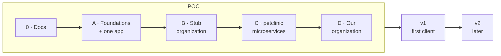

# Roadmap

Where Steno is going and where each piece stops: the **proof of concept** (stages 0 and A–D), **v1** (first delivery to a client), and **v2** (later). Part of [Plan](./README.md). Decided (D94).

> **In one minute**
> - **POC:** prove Steno answers accurately, first on one application, then on a stub organization we wrote (so the correct graph is known), then on real multi-service code, then on our own organization's application.
> - **Accuracy is the bar.** Every stage is measured with a question set and against an agent working without Steno.
> - **Rules keep up by curation** (D120): Steno drafts rules for what its coverage report can't explain, and a person approves them. Built and measured in the POC, on Java first.
> - **v1** adds what a client deployment needs: connectors to systems reached through an API, catalogs as witnesses, a guided onboarding UI, MCP authentication.
> - **v2** holds Jev, runtime evidence, frontends, data store schemas, ownership, and environments.

---

## 1. Where we are

| Built | Not built |
|---|---|
| Onboarding UI and Admin API; organization and spaces projected into Neo4j | Bulk onboarding and repository roles in the UI (`v1`, D111) |
| Job queue (Postgres), worker, per-stage records, nightly runs, write-only-changes, `fact_change`; re-ingesting the same commit writes nothing | Removing a deleted repository's facts (`v2`) |
| **Identity** (D81–D84): registry, identify stage, Steno IDs keying every child ID, names from build files, `spring.application.name`, and other witnesses; conflicts, tombstones, restores | Naming patterns; admin links through an API or UI; application kinds |
| **Claims and reconcile** (D109, D114): pack witness types, record rules (`each`, `when`, XML), the claim store, reconcile for Messaging, agreement and sources on application-level edges, stubs for unmatched names | Schedules reconciliation; declared topic placement; the setup sheet |
| Packs: Python (9), Java (13), Strimzi (PLATFORM), Backstage (DECLARED); every rule with tests, including Spring Boot 2 cases; HTTP signatures; versions each pack is tested on (D106) | Organization packs (XLD repository, `component_manifest.yaml`) |
| Python resolver; Java resolver with the JVM helper (source and JDK, Lombok, the repository's Java level) | Dependency JARs; Artifacts link across repositories |
| Rule engine, assemblers, call graph, flows, traces, steps, inferred flows (D74), interceptors and access (D103), ORM effects (D102), the ledger of I/O and hooks (D101) | Routing joins |
| Coverage report (signals including disagreements, unmatched names, untested versions; triage; org-wide view by scope) | Agreement view; cross-application inconsistencies |
| MCP: `search` (with data stores, external systems, aliases), `get_node` (names, agreement, `claims`), `get_flow`, `view_flow_code`, `find_dependents`, a completeness block in answers, all logged | Confidence levels; LLM cards; commits → PRs |

Contextualized (Python) and budgeting-app (Java) ingest end to end, and a three-repository stub organization (a producer, a consumer, and a platform repository with Strimzi topics and ACLs) proves claims and reconcile. Current stage: **A**.

## 2. POC stages

| Stage | Scope | Done when |
|---|---|---|
| **0 · Docs** | Restructure the documentation (this site) | The owner signs off on the structure |
| **A · Foundations + one app** | Identity registry and identify step (Steno ID, name ladder, aliases, lifecycle, manual renames); application kinds; witness type and sources on every fact; completeness block in MCP answers; **reconcile technical design**; question set with scoring for budgeting-app (and Contextualized), plus the comparison without Steno | Question set scored. Re-ingesting the same commit changes nothing. Application IDs stable across renames and moves. |
| **B · Stub organization (the test bed)** | A fixture in this repository: a few small services across two spaces, written so every facet, agreement state, and identity case appears at least once: <ul><li>two services sharing an internal library (**Artifacts A1**) that brings a header-requiring filter and a response wrapper the services turn on by dependency, annotation, and config (**interceptors**, D116)</li><li>a DTO shared by two endpoints with different validation groups, a nested `@Valid` field, and a polymorphic message (**contracts**, D115)</li><li>a gateway route (**Routing**)</li><li>a Kubernetes CronJob (**Schedules**)</li><li>a table one app owns (migrations) and another writes (**Data**)</li><li>an ACL file with a deliberate mismatch (**Messaging agreement**)</li><li>a manifest (**Components**)</li><li>HTTP and Kafka between services, a vendor API</li><li>scripted rename, move, rename-and-move, split, removal, and two repositories claiming one name</li></ul> | The graph matches the known correct graph. After each scripted change, re-ingestion leaves no duplicates and no dead flows. Join rate and agreement are computed. |
| **C · Real multi-service code** | [spring-petclinic-microservices](https://github.com/spring-petclinic/spring-petclinic-microservices): **Routing** through Spring Cloud Gateway and Eureka `lb://` names; **Components** names from `spring.application.name`. Stretch: the [OpenTelemetry Demo](https://github.com/open-telemetry/opentelemetry-demo) (many languages, Kafka, gRPC). | Cross-service flows match a hand check. Question set scored. |
| **D · Our organization's application** | `component_manifest.yaml` (DECLARED Components); the XLD repository (PLATFORM Messaging and deploy names); internal libraries (Artifacts A1, then the **A2** design); onboarding steps 1–8 run on our own organization as a dry run; LLM cards and the **cost dry run** | The POC exit criteria (§3) |

**Facets by stage** (D88):

| Facet | Stage |
|---|---|
| Identity foundations, witness types on facts | A |
| Artifacts A1, Schedules (PLATFORM), Data ownership, Messaging agreement | B |
| Routing, Components names | B → C |
| Components (manifest), Messaging (XLD repository), Artifacts A2 | D |

## 3. POC exit criteria

For our organization's application and its neighbors:

1. **Question-set accuracy** meets the target, in **≤ 3 tool calls** per typical question.
2. **No confidently wrong answers:** every gap is shown (completeness block, incomplete flows, unjoined sends).
3. **Join rate and agreement** are measured and meet their targets.
4. **Re-ingestion leaves no duplicates or dead flows**, and re-ingesting the same commit writes nothing.
5. **Clearly better than an agent without Steno** on questions that span services.
6. For the application itself (carried over from the original single-application criteria): ≥ 90% of endpoints, topics, and outbound calls found against a hand-labeled gold set; flows match the gold set for the top entry points.

## 4. Evaluation

| Measure | How |
|---|---|
| **Rule curation** | A pack we wrote, hidden, re-derived by curation and compared with the original (precision and recall); frameworks with no pack on public Java code (FTGO, Axon samples, Spring Cloud Stream samples, PiggyMetrics, ThingsBoard: to check before use), each with a small answer key; LLM cost per pattern and framework, review time per rule, revision rounds; both drafter backends ([rule curation §10](../how-it-works/ingestion/rule-curation.md#10-measuring-it)) |
| **Large repositories** | The two-pass Java resolver gives the same results as the single pass on repositories the single pass can handle; then peak heap, peak memory, and time on very large public Java repositories (Elasticsearch or OpenSearch, Kafka, Keycloak, ThingsBoard; sizes to check) |
| **Question set** | 10–15 questions per target, **drawn from the [lead use cases](../purpose/use-cases.md#lead-use-cases-in-detail)**, expected answers written first: find a flow ("what happens when a budget is created?"), dependents ("what reads or writes `transactions`?"), triggers ("how do I start flow X?"), scheduled work, where logic lives. Scored on correctness, tool calls (from `tool_call`), and whether gaps were stated. |
| **Comparison without Steno** | The same questions to Claude Code with the repositories checked out and no Steno. Expect a small gap on one application and a large one across services. |
| **Gold set** | Hand-labeled endpoints, topics, outbound calls, data access, and 10–20 key flows for one application. Precision and recall per fact type; flow step accuracy. |
| **Known graph** | The stub organization's correct graph, written by us |
| **Consistency** | Re-ingesting the same commit produces zero `fact_change` rows; a fresh ingest equals a nightly run at the same commit |
| **Agnostic check** | A public multi-language system (the OpenTelemetry Demo) so the design doesn't overfit our organization |
| **Calibration** (`v2`) | Predicted confidence vs. actual accuracy for decisions |

## 5. Build order for D115–D127

Decided on 2026-10-20. In order; each step is usable on its own:

| # | Work | Decisions | Stage |
|---|---|---|---|
| 1 | **Answers say what they checked:** `checked` / `not_checked` and unexplained counts in completeness; the `sources` block; the depth rule in the MCP server instructions. **Built.** | D118, D119 | A |
| 2 | **Java at scale:** peak memory recorded per stage first (so the rest is measured); streamed output into an on-disk index; module isolation; the two-pass resolver behind the differential test; the large-repository benchmark. **Built:** memory per stage, the two-pass resolver and its differential check, work sized to the machine (D128). Then traces stored compact (ThingsBoard's worker peak: 4.6 → 1.5 GB) and the helper's output streamed. **Next:** flows per application, an on-disk index for the helper's output, module isolation | D127, D128 | A |
| 3 | **Patterns:** fingerprints and occurrence keys; org-wide patterns and their states; the unread-files and unread-config signals; scoring; clustering into frameworks. Deterministic, no LLM. **Built:** fingerprints, occurrence keys, patterns and states, reach-based scores, clustering by owner, `GET /api/patterns`. Unread files and config, the packs' `noise` block, three kinds of evidence, triage on patterns. **Built.** | D121–D123 | A |
| 4 | **Rule curation:** the authoring kit (`vocabulary()` from the code's schema, `match_existing`, the rules index, samples, `test_rule`, `shadow_run`); both drafter backends; proposals and their store; the review UI; commits authored by Steno; the budget gate and pilot; rule health | D120, D123–D126 | A → B |
| 5 | **Measure curation** on Java: the hidden pack, then frameworks with no pack (§4) | D120 | B |
| 6 | **Contracts:** entity fields and constraints (Bean Validation, Jackson packs), `HAS_FIELD`, `USES_ENTITY` with its usage, the `validates` tag, `get_interface` | D115, D117 | B |
| 7 | **Interceptors as nodes:** the node, kinds, phase, `requires` / `adds`, `ACTIVATES`, `INTERCEPTED_BY`; library activation once Artifacts A1 is built | D116 | B |

## 6. v1: first delivery to a client

- **Connectors to systems reached through an API:** XLD server, Kafka admin API, artifact repository, scheduler
- **Catalogs as witnesses:** Backstage, Cortex (DECLARED) (D96)
- **Witness mappings drafted by curation:** "map `component_manifest.yaml` to Components?", approved by a person
- **The onboarding UI:** setup sheet, guided coverage and agreement review
- **Repository discovery** and placement rules
- **MCP authentication** and scoping by space or role; deployment model for client environments
- **Commits mapped to PRs** (`job_commit`); `get_changes`, `analyze_change`
- **Artifacts A2**, if not finished in the POC
- Org-scale rollups and confirmation by space owners (the original space and organization goals)

## 7. v2 and later

See [Later](./later/README.md): Jev, runtime evidence (OBSERVED), frontends, data store schemas (Data V2), Ownership and Environments facets, the Contextualized integration (attribution), entity-anchor retrieval, visualization enhancements.

## 8. Not planned

- **Building the tools that use the context** (test generators, CI bots, incident copilots), or the harness that clones and manages workspaces for agents: agents and workflows build those on top ([use cases](../purpose/use-cases.md#scope-boundary), D119).
- **Version history and time travel** beyond the change log (`fact_change`) and tombstones.
- **Replacing a catalog or CMDB** (D96).
- **Requiring anything of an organization's repositories** (D75).

## 9. Risks

| Risk | Impact | Mitigation |
|---|---|---|
| Static call graphs miss DI, reflection, and dynamic dispatch | Missing or wrong flow steps | Symbol resolvers, DI rules, candidates marked `ambiguous`, the coverage report; PLATFORM witnesses; runtime evidence later |
| Java resolved without dependency JARs (D69) | Flows stop partway through library chains (fluent clients, Reactor) | Unresolved calls stay visible and are counted per library (D71); JARs added in the order the counts justify |
| A rule misses something and nobody notices | An impact answer leaves out a consumer | Second witnesses and the agreement view; join rate and orphan receivers; completeness block in answers |
| Joins that aren't in code (gateways, env values, discovery, schedulers) | Unjoined calls; missing triggers | The Routing and Schedules facets (PLATFORM) |
| Application names don't match what the organization uses | Inference everywhere; duplicates on rename | The identity registry and name ladder (D81–D84) |
| Flows can't be found from business-language questions | Search misses the right flow | LLM flow cards, several retrieval signals, verification, measured with the question set |
| Rules overfit to our organization | Not agnostic | Fixed facets, shared packs, a public second target |
| Too many witnesses of uneven quality; credentials for many systems | Maintenance and security cost | Witnesses read by packs with tests; read-only connectors with narrow scopes; `v1` only |
| Steno drifts into being a catalog or CMDB | Wasted effort | Facets only for what the graph models (D79); catalogs are witnesses (D96) |
| A catalog vendor adds code analysis | Competition | Effort goes into what's hard: flows, joins across services, completeness |
| Enterprise scale | Slow ingestion and queries | Traces instead of function nodes, nightly runs only for changed repositories, per-file caches, materialized rollups, measured early |
| Data egress policy | Blocks LLM cards or a decision model | Confirm early; deterministic first means Steno is useful with LLM cards off |
| Too many round trips for agents | Slow | Calls per question measured from `tool_call`; batch tools where logs show chatty patterns |
| Rules for internal frameworks can't keep up by hand | Gaps grow as code changes | Rule curation (D120): Steno drafts, proves, a person approves; rule health alarms (D126) |
| An LLM drafts a wrong rule | Confidently wrong facts | Tests, a shadow run with near misses and confirmation rates, and a person's approval before any rule runs; rule health after |
| Curation cost, especially the first run | Spend before value | Deterministic grouping first, caps per pattern, a budget per run, a pilot, and an approved ceiling for v0 (D121) |
| Very large Java monorepos | Out of memory, a failed repository | Two-pass resolution in batches, streamed output, module isolation, peak memory tracked per stage (D127) |
