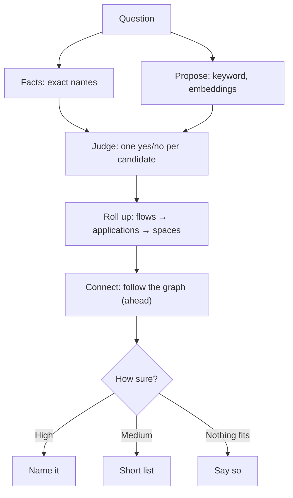

# Routing design

What was measured behind flows-first routing, and what's still ahead. The approach is Decided (D150) and built. Connected flows in answers, the service directory, and the points in §8 are not.

> **In one minute**
> - **Propose widely, let Jev judge each candidate on its digest, and work out applications and spaces from the winners.** Jev found the right flow far more often than keyword search or embeddings, and separated "no answer here" from real answers.
> - **The largest gap was links between flows:** the measured graph had none. Links across repositories are now built (D150); following them in answers isn't.
> - **Reading code can't prove a call,** so every link states its evidence.

## 1. What we measured

On 2026-11-04: 4 applications, 166 flows, `jev-1.14.0`, every flow judged per question.

| Method (first / top 5 / top 10) | 15 direct | 11 vague |
|---|---|---|
| Keyword search | 9 / 11 / 11 | 0 / 0 / 0 |
| Local embeddings, full digest | 7 / 11 / 14 | 4 / 8 / 8 |
| **Jev, full digest** | **14 / 15 / 15** | **8 / 10 / 11** |
| Jev, name and docs only | 12 / 12 / 13 | 8 / 10 / 11 |
| Jev, name plus one LLM sentence | 11 / 14 / 14 | 7 / 10 / 10 |

| Test | Result |
|---|---|
| Application from its summary line, first | 12 of 15 direct, 7 of 11 vague |
| Application from its best flow, first | 14 of 15 direct, 10 of 11 vague |
| 3 questions with no answer | No flow above 0.38; answerable questions reached 0.53+ |
| Rated 0.9 or above | 15 of 16 were expected answers |
| Embeddings as a proposer | Right flows in the top 50 for all 29 questions |
| Cost | 4.1M Jev tokens, about $0.17 |

**Through real `search`** (right flow first / in the answer): direct 14 / 15, vague 8 / 11, cross-application 2 / 3. All 3 no-answer questions said nothing fits.

**How far to trust this:** small, one run, written knowing the flows, no Kafka. **It says nothing about accuracy with hundreds of applications.**

## 2. The design

1. **Facts first.** Code settles exact names.
2. **Propose widely:** keyword and fuzzy search, embeddings, later graph lookups. Candidates include topics, tables, and external systems.
3. **Judge.** One yes/no per candidate, kept alone, because Jev does worse with unrelated state.
4. **Roll up.** Summaries don't choose where to look.
5. **Connect (ahead).** Follow the graph from the winners, keeping each link's certainty. Never turn "no known caller" into "called by".
6. **Say how sure.** About 0.9+ names it, 0.5–0.9 is a short list, and below 0.5 says nothing fits. Starting points, to tune.

Every judgment can be shown: `steno route "<question>"`.

## 3. Connecting flows across applications

**Reading code can't prove a call.** Values can differ per environment, and only runtime evidence proves one (`v2`). So every link states what it rests on.

| Certainty | Example evidence | Status |
|---|---|---|
| **Confirmed** | A host equals a known name and the path exists; a shared topic; a gateway route | Built |
| **Inferred** | A name with a runtime part that fits one application | Built |
| **Declared** | A manifest or an admin says so | Proposed |
| **Possible** | A weak path match: a hint, not followed | Built as `possible_targets` |
| **Unknown** | Nothing fits | Built |
| **Observed** | Runtime traces | `v2` |

**The service directory (Proposed).** What each service is called, everywhere, per environment, from witnesses: `spring.application.name`, OpenShift resources, XLD dictionaries, gateway routes, manifests, and admins. Secrets are never needed. Matching stays strict (D82).

**Jev can't make this call alone.** Across 118 endpoints, a wrong link (`PlaidClient POST /transactions/sync` to budget-app's own endpoint) scored 0.90, higher than the right one at 0.59, because Jev mostly reads the path. So code checks come first: not the caller itself, every path must fit, and names must match. Jev only compares what survives.

**Also needed:** a fixture with a chain across three applications, and a "connected flows" section in answers.

## 4. Cards

- **Flows:** the full digest. An LLM sentence alone was weaker.
- **One-sentence purpose (agreed, cheap model):** on top of the digest, from people's own words where they exist. Roughly $10 per 10,000 flows from digests, perhaps $75 from code.
- **Applications and spaces:** summaries stay useful for people, and as one signal.
- **Vocabulary:** internal names must be in what Jev reads. The glossary belongs with Constraints.

## 5. Scale

10,000 flows: propose about 200, and Jev judges about 30k tokens, about $0.001 per question (estimated).

**Risks:** embedding recall (the top 50 worked, but that's 30% of 166 flows), similar flows, and rate limits. The real measure is the question set at the organization (D144).

## 6. Jev for the coverage report

**Proposed:** one yes/no per pattern to sort the report and flag noise. It doesn't replace filtering or the skill, and never closes an item alone. Test on patterns already triaged first.

## 7. Order of work

| # | Work | State |
|---|---|---|
| 1 | Jev backend, one candidate per question, the trace | Built |
| 2 | Embeddings as a proposer | Built, optional |
| 3 | Candidates of every kind, rolling up | Built |
| 4 | Chain fixture, cross-repository names, service directory, certainty, connected flows | Names and certainty built; the rest ahead |
| 5 | Thresholds and "nothing fits" | Built; tuning ahead |
| 6 | One-sentence purposes, better application cards | Ahead |
| 7 | Jev sorting coverage | Proposed |

## 8. Questions to settle

1. One-sentence purposes: every flow or only undocumented ones? From the digest or the code?
2. Where do service URLs live at the organization? The directory's shape depends on it.
3. Is a made-up scale test acceptable, given D144?
4. Should Jev sort coverage in the POC?
5. Which certainty levels may an agent's walk follow automatically? Proposed: Confirmed, Declared, Inferred, each stated.

**Data policy:** only our own repositories have gone to Jev. The organization must sign off first.
