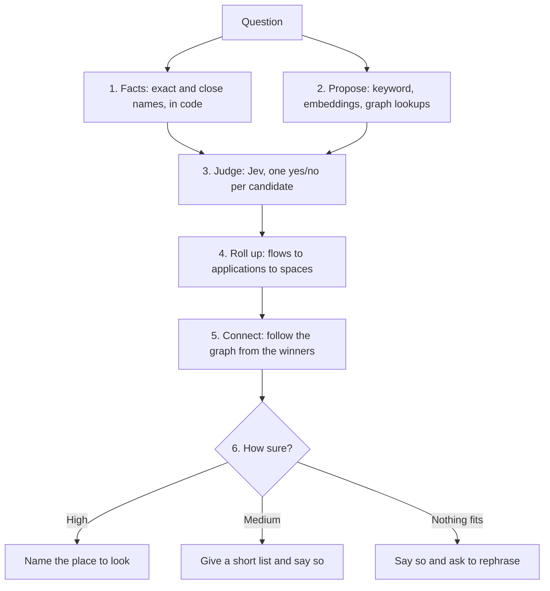

# Routing design: finding where to look across an organization

**Status: flows-first routing is built for Flows; other candidate kinds and connected flows in answers are still ahead. Four points were agreed on 2026-11-04 (section 8), and none is in the decision log yet.** If accepted, it revises D100, D142, and D143 and answers the embeddings questions left open by D22 and D54. Scope is `POC` stage A unless a point says otherwise.

> **In one minute:** Steno should take a vague question and return the applications, flows, and entities to look at, how they connect, and how sure it is. Today's design narrows top down: space summary, then application summary, then keyword candidates. A test on our 166 real flows suggests a different shape: **propose widely, let Jev judge each candidate on its digest, and work out the applications and spaces from the winners.** Jev found the right flow far more often than keyword search or embeddings, and it separated "no answer here" from real answers. The largest gap is elsewhere: **our graph has no links between flows today**, so Steno can't yet follow a process across applications. Links between applications need a directory of what each service is called, and every link must state its evidence, because reading code can't prove a call.

---

## 1. What we measured

Run on 2026-11-04 against the dev graph: 4 applications, 166 flows, `jev-1.14.0`. Every flow was judged for every question, with no pre-filtering.

**Right flow found** (first / top 5 / top 10):

| Method | 15 direct questions | 11 vague questions | 3 cross-application (all parts in top 10) |
|---|---|---|---|
| Keyword search (today) | 9 / 11 / 11 | 0 / 0 / 0 | 0 |
| Local embeddings, full digest | 7 / 11 / 14 | 4 / 8 / 8 | 1 |
| Jev, full digest | **14 / 15 / 15** | **8 / 10 / 11** | **3** |
| Jev, name, trigger, and docs only | 12 / 12 / 13 | 8 / 10 / 11 | 2 |
| Jev, digest with docs removed | 13 / 15 / 15 | 8 / 8 / 9 | 3 |
| Jev, docs removed, one LLM sentence added | 14 / 15 / 15 | 8 / 9 / 11 | 3 |
| Jev, name plus one LLM sentence only | 11 / 14 / 14 | 7 / 10 / 10 | 3 |

**Other results:**

| Test | Result |
|---|---|
| Picking the application from its summary line | First: 12 of 15 direct, 7 of 11 vague |
| Picking the application from its best flow | First: 14 of 15 direct, 10 of 11 vague |
| 3 questions with no answer in these repositories | No flow above 0.38 (full digest); every answerable question had a flow at 0.53 or more |
| Flows Jev rated 0.9 or above | 15 of 16 were an expected answer |
| Flows Jev rated 0.7–0.9 | 19 of 55 were an expected answer (labels are narrow, so some others may be reasonable) |
| Embeddings as a proposer | The right flows were in the top 20 for 26 of 29 questions, and the top 50 for all 29 |
| 7 questions about a table, vague or misspelled | First for 5, top 2 for 6, 8th for 1 |
| Cost | 4.1M Jev tokens, about $0.17. Average 0.4 s per call; one call took 4 s |
| Links between flows in the live graph | **0** |

**How far to trust this:** it's a small test, one run, on 4 applications, with questions we wrote knowing the flows. 131 of the 166 flows have docstrings. There is no Kafka in this graph, so topics weren't tested. It shows a direction; **it says nothing about accuracy with hundreds of applications.** The LLM sentences were written by Haiku from digests alone, not from code.

---

### Measured through real `search` (2026-11-04)

Jev reading each proposed flow, on our graph. "In the answer" means named or in the shortlist:

| | Right flow first | In the answer | Right applications all named |
|---|---|---|---|
| 15 direct questions | 14 | 15 | 15 |
| 11 vague questions | 8 | 11 | 11 |
| 3 cross-application questions | 2 | 3 | 3 |

All 3 questions with no answer said nothing fits. With Jev limited to names, keyword search, and semantic search's top 40 of 168 flows, results were the same except 1 of 3 cross-application questions first. The stand-in stays as it was: 9 and 13 of the 15 direct questions, 13 applications first. The same small-set limits apply. Questions were written knowing the flows, and it hasn't run at scale.

## 2. The design

### Step 1: Facts first

Code finds what it can settle exactly: names, paths, topics, table names, and close spellings of them. A match is passed on as a fact, and it goes straight to the answer when it's exact. This is the "code makes decisions" half of Jev's guidance.

### Step 2: Propose widely

The goal here is to not lose the right answer, not to pick it. Candidates come from every source and are merged:

- **Keyword and fuzzy search**, for names and exact words.
- **Embeddings over digests and cards**, for meaning. A local model costs nothing per query and keeps the text inside the organization. This keeps D22 and D23, and removes the reason to wait for a cost dry run.
- **Graph lookups**, when the question describes a relationship ("written by the monthly job").

Candidates aren't only flows: they also include topics, tables, endpoints, and external systems, so a vaguely described topic is found the same way.

### Step 3: Jev judges each candidate

One yes/no per candidate, with each candidate's text kept in its own question. A candidate is never judged next to unrelated digests, following Jev's guidance on unrelated state. If a question needs several answers, several candidates simply score high.

### Step 4: Work out applications and spaces from the winners

An application's score comes from its best flows, and a space's from its applications. **Top-down routing is removed (agreed).** Summaries don't choose where to look. A question touching 5 spaces returns those 5 because flows in each scored well, and no summary has to anticipate it.

### Step 5: Connect

From the winners, code follows the graph in both directions: what started this flow and who calls it, then what it calls, shared topics, and shared tables. Every step keeps its certainty (section 3). Where a walk fans out widely, Jev scores which branches are relevant (N2).

The answer distinguishes these, and never turns the last into the second:

- **Called by service B**, with the link's certainty.
- **Reachable from outside**, through a gateway route (D132).
- **No known caller.** It may be a UI or a service Steno can't see. It's only called UI-driven when a frontend repository or a gateway shows it.

### Step 6: Always say how sure

| Situation | What Steno does |
|---|---|
| A candidate at about 0.9 or above | Names it |
| Candidates at about 0.5–0.9 | Gives a short list, says it's unverified, and shows why each came up |
| Nothing above about 0.5 | Says nothing fits, shows the closest, and suggests rephrasing or asking the user |

These numbers are starting points, to be tuned on the organization's question set. They use Jev's raw probability of yes. Jev's separate `confidence` field describes the spread of an answer, not whether it's correct, and nothing is labeled "calibrated" until measured.

### The trace

Every search can show each judgment with its probability, and each fact code used. A command prints this for any question, so a miss can be traced to a bad card, a bad judgment, or a bad rule.

---

## 3. Connecting flows across applications and spaces

**The model supports this. The live graph doesn't have it yet.** A flow that calls or produces to an interface that starts another flow leads to that flow, and `get_flow` computes this when read. In our graph it never fires, and no test covers it.

**Two reasons it doesn't fire:**

1. **The host is set outside the repository.** `budget-app` calls `${suggestion-engine.base-url}` + `suggestion`, and that key has no value in its repository. The target becomes "Unknown host". `get_flow` can list endpoints with a matching method and path as a hint, never an edge (D100, D64).
2. **Service names don't resolve across repositories.** A bare host such as `http://orders-svc/...` or a Feign name joins only an application in the same repository; otherwise it becomes an `ExternalSystem`. An organization with one repository per service gets no links this way. This needs identity read across ingestions, as reconcile does for routes.

### Reading code can't prove a call

The value can differ per environment, and may only exist on the server. **Only runtime evidence proves a call** (OBSERVED, `v2`). So the goal isn't a guarantee. It's that every link states what it rests on, and an uncertain link never reads as a fact.

### The service directory

**Yes, a dictionary is needed.** It answers "what is each service called, everywhere?", and it gives a link something to attach to when a service never states its own URL. It's built from witnesses, per environment where values differ:

| Source | What it gives | Witness |
|---|---|---|
| `spring.application.name`, build artifact | The service's own names | CODE |
| OpenShift Service, Route, Deployment, image | Service names, route hosts, per environment | PLATFORM |
| XLD dictionaries, ConfigMaps, Helm values | A config key's value, per environment | PLATFORM |
| Gateway routes (D132) | Public path to service | PLATFORM |
| `component_manifest.yaml`, catalogs | Declared names and dependencies | DECLARED |
| An admin | Anything else | ADMIN |

- **Secret values are never needed or read.** Hostnames are rarely secrets. When a value is hidden, its key's name (`ORDERS_URL`) is still evidence.
- **It extends existing work:** application aliases (D81, D82) and per-environment bindings (Environments design).
- **Matching stays strict (D82):** exact names and aliases are facts. Anything looser is marked inferred.

### Certainty on every link

| Certainty | Example evidence | How an answer states it |
|---|---|---|
| **Confirmed** | Host or Feign name equals a directory name, and the path exists; the same topic name on both sides; a gateway route | "Calls" |
| **Declared** | A manifest or an admin says so | "Declared to call" |
| **Inferred** | The config key's name matches a directory alias, and every path the client calls exists on that service | "Probably calls", with evidence and score |
| **Possible** | One or a few weak path matches | Listed as a hint, not followed automatically |
| **Unknown** | Nothing fits | Stays "Unknown host", on the coverage report |
| **Observed** (`v2`) | Runtime traces or a service mesh | Upgrades or contradicts any of the above |

An answer containing any link below Confirmed says so. Decisions are kept in Postgres, so the graph stays rebuildable (`jev_decision`).

### What we measured: Jev can't make this call alone

One yes/no per call and candidate endpoint, across 118 endpoints:

| Call | Jev's top pick | Right? |
|---|---|---|
| `SuggestionEngineClient POST /suggestion` | `budgeting-app-inference POST /suggestion`, 0.59 | Yes, but only moderately sure |
| The same, with the target removed from the candidates | Top score 0.03 | Yes, nothing fits |
| The same names, path changed to `/predict` | Top score 0.08 | Unproven; shows the path dominates |
| `PlaidClient POST /transactions/sync` | `budget-app POST /transactions/sync`, **0.90** | **No.** That's Plaid's path, and budget-app's own endpoint |
| Other Plaid, Jira, Confluence, Bitbucket calls (14) | All 0.14 or lower | Yes, nothing fits |

**A wrong link scored higher than the right one**, because Jev mostly reads the path. This confirms the rule in [joins](../how-it-works/ingestion/joins.md): paths never name a service.

**So code checks come first, and Jev only judges what's left:**

1. **Not the caller itself:** a client whose host comes from config isn't assumed to call its own application.
2. **Every path must fit:** `SuggestionEngineClient` calls 1 path, and all fit. `PlaidClient` calls 5 and only 1 fits, so it isn't that service.
3. **Names:** the key `suggestion-engine.base-url` matches the service `suggestion-engine` in `compose.yaml`, which could give `budgeting-app-inference` that alias. Confirming the alias is what would make this link solid.
4. **Jev:** used to compare candidates that survive 1–3, as one input to Inferred. Its score alone never makes a link.

**Limits:** this is one true case and a few false ones. Common paths such as `/health`, single-path clients, and generic client names weren't tested, and they're the hard cases. Our organization's real configuration is what decides this.

**Also needed:** a test fixture with a chain across three applications, covering HTTP and a topic, and a "connected flows" section in answers, so an agent doesn't have to walk the chain one call at a time.

**Not tested yet:** finding a topic described only by who produces to and consumes from it. The dev graph has no topics, so this needs the fixture above.

---

## 4. Cards

- **Flows:** use the full deterministic digest. It beat the shorter versions on direct questions, and an LLM sentence alone was weaker than the digest. Digests average about 150 tokens, smaller than the 300–600 in our earlier estimate.
- **A one-sentence purpose (agreed, with a cheap model):** added on top of the digest, at ingestion. With docs removed, it improved vague questions from 9 to 11 in the top 10. It's written from people's own words where they exist: docstrings, OpenAPI descriptions, catalogs.
- **Cost of that sentence:** at the rate of our earlier Sonnet run, roughly $10 per 10,000 flows from digests and perhaps $75 if it reads code, once, then only for flows that change. These are estimates. A cheaper model lowers them, and D143's cost worry looks smaller than we assumed.
- **What the sentence can't do from a digest:** it can't add facts. "Validates your banking information" needs the docs or the code, so reading the code should be tested on undocumented flows at the organization.
- **Applications and spaces:** LLM summaries stay useful for people, and as one signal. Routing leans on facts and flows, which addresses the worry that a summary is a guess at someone else's meaning.
- **Application cards:** one line plus capabilities, entities, topics, tables, external systems, and aliases, about 100–150 tokens. Add what separates it from similar applications.
- **The organization's vocabulary:** Jev doesn't know internal names and abbreviations, so aliases and a glossary must be in what it reads. The glossary belongs with Constraints.

---

## 5. Scale

| Layer | Approach | Estimated size per question |
|---|---|---|
| 10,000 flows | Embeddings and keyword propose about 200; Jev judges them | ~30k tokens, about $0.001 |
| Requests | 64k tokens each; no limit on question count; split and run in parallel | 1–3 calls per step |

**The risks at scale:**

- **Embedding recall:** the top 50 worked on 166 flows, but that's 30% of them. This is the first number to measure at the organization.
- **Similar flows:** many services with near-identical flows will be harder to tell apart than our repositories.
- **Rate limits:** set per organization and shown in the console.

**Testing it:**

- Mix our real flows with hundreds of realistic made-up ones, to see whether the right ones still surface. This touches D144 ("no mock organization"), so it's the user's call.
- The real measure stays the question set at the organization (D144).

---

## 6. Jev for the coverage report

**Proposed:** one yes/no per coverage pattern, such as "does this call reach outside the application?", to sort the report and flag likely noise. This is decision I8 in the [Jev design](./later/jev.md), brought forward from `v2`.

- **It helps with:** ordering the report and cutting what a person or the skill has to read. It's far cheaper than an LLM reasoning through each item.
- **It doesn't replace:** deterministic filtering first, or the `rule-pack-author` skill learning a library and writing rules (D147).
- **The safeguard:** Jev never closes an item by itself. Anything it marks as noise stays listed and reversible, and a sample gets checked.
- **Test first:** run it on patterns we've already triaged by hand and compare. This hasn't been tried yet.

---

## 7. Order of work

| # | Work | Why here |
|---|---|---|
| 1 | Jev backend, one candidate per question, the trace | Everything else needs it |
| 2 | Embeddings as a proposer (local model) | Fixes vague questions, which keyword search can't find |
| 3 | Candidates of every kind, and rolling up to applications and spaces | Replaces the top-down gate |
| 4 | The chain fixture; service names across repositories; the service directory; certainty on links; connected flows in answers | Multi-space questions depend on it |
| 5 | Thresholds and the "nothing fits" answer | Needs logged decisions from 1–3 |
| 6 | One-sentence purposes for undocumented flows; better application cards | Measured against the question set |
| 7 | Jev sorting the coverage report | Independent; can move earlier |

---

## 8. Questions to settle

**Agreed on 2026-11-04, to go in the decision log once the design settles:**

- Top-down routing is removed: flows are the source of truth, and applications and spaces follow from them.
- Embeddings come into stage A as a proposer, with a local model.
- Links can be inferred, carrying their confidence and evidence, never presented as guaranteed.
- One-sentence flow purposes are written with a cheap model.

**Still open:**

1. Are one-sentence purposes written for every flow, or only undocumented ones? And from the digest, or from the code?
2. Where do service URLs actually live at the organization: `application.yaml`, OpenShift manifests in a repository, XLD dictionaries, or set only on the servers? The directory's shape depends on this.
3. Is a made-up scale test acceptable, given D144?
4. Should Jev sort the coverage report in the POC?
5. Which certainty levels may an agent's walk follow automatically? Proposed: Confirmed, Declared, and Inferred, each stated in the answer.

**Data policy:** so far only our own repositories have gone to Jev. Jev says it doesn't train on customer data and hosts in the US; retention has no stated number of days, and zero retention is enterprise-only. The organization needs to sign off before its data is sent.
