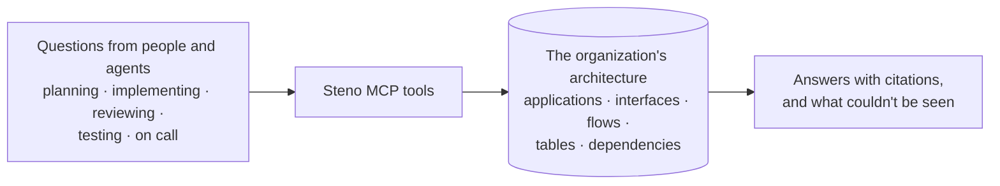

# Purpose and use cases

What Steno is for, who uses it, and the questions it has to answer well. The use cases here drive everything else: **a feature belongs in Steno only if a use case needs it.**

> **In one minute**
> - Agents are strong inside one repository and blind beyond it. Most of what matters for a change (who consumes this topic, which flows cross this service, what breaks downstream, how to trigger and test a flow) lives outside it.
> - Steno answers **"what is"**: the organization's architecture as it runs today, derived from code, current, and cited.
> - Five **lead use cases** set the bar: PR review with context, breaking-change checks, "grill me" planning, delta-driven testing, and stack trace to flow. Each is a set of questions with answers we can check, and the POC's question sets are drawn from them.
> - Steno supplies the context. The tools and workflows that use it (review bots, planning workflows, test generators, and eventually an agent-first SDLC) are built on top, elsewhere.

## Pages

| Page | What it covers |
|---|---|
| [Use cases](./use-cases.md) | The lead use cases in detail (questions, tools, what a correct answer contains), then the full catalog |
| [Where Steno fits](./where-steno-fits.md) | What Steno owns and doesn't, why an agent with every repository isn't enough, and the guarantees Steno makes |
| [Integration](./integration.md) | What Steno provides to other systems that build on it: stable IDs, planned IDs, change history, attribution hooks, MCP |

## Why it's worth it

1. **Tribal knowledge stops decaying.** "How does this fit together?" lives in senior engineers' heads and leaves with them. A living graph keeps it.
2. **Discovery is paid for once.** Every new hire, contractor, and fresh agent session re-derives the same picture from scratch. A shared graph pays that cost once.
3. **Senior judgment scales.** "This breaks something downstream" or "this already exists" runs on every change, without waiting for the few people who know.
4. **One engineer with an agent can work at organization scale,** changing things across services and spaces while keeping the patterns that have been in place for years, because the agent can see the whole organization.

## Who uses it

| Who | Typically asks |
|---|---|
| An engineer (or their agent) implementing a change | Where does this live? What else must change? Who depends on this? |
| A reviewer (or a review bot) | What does this PR actually touch beyond the diff? |
| A dev manager or lead planning work | Which services, spaces, and flows does this project touch? What's unanswered? |
| A tester (or a test agent) | How do I trigger this flow, with what input, and what should I check afterward? What's downstream? |
| On call | Which flow does this stack trace belong to? Who's affected? |
| A platform or architecture team | Where do declarations and code disagree? What's unused? Where do spaces reach into each other's data? |
