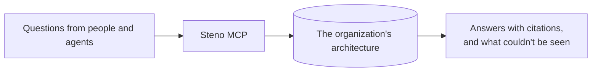

# Purpose

What Steno is for and who uses it. **A feature belongs in Steno only if a use case needs it.**

> **In one minute**
> - Steno answers **"what is"**: the architecture as it runs today, derived from code, current, and cited.
> - Five **lead use cases** set the bar: PR review with context, breaking-change checks, "grill me" planning, delta-driven testing, and stack trace to flow.
> - **Steno matters when a change touches an application's surface,** or when an agent needs to invoke a flow (D136).
> - After the POC it becomes the organization's **context layer**, adding Projects and Constraints (D141). Tools that use the context live in other repositories.

## Pages

| Page | Covers |
|---|---|
| [Use cases](./use-cases.md) | The lead use cases and the full catalog |
| [Where Steno fits](./where-steno-fits.md) | Boundaries, guarantees, breadth and depth |
| [The context layer](./context-layer.md) | Projects and Constraints (`v1`) |
| [Integration](./integration.md) | What Steno offers systems built on it |

## Who uses it

| Who | Typically asks |
|---|---|
| An engineer or their agent | Where does this live? What else must change? Who depends on this? |
| A reviewer or review bot | What does this PR touch beyond the diff? |
| A lead planning work | Which services and flows does this touch? What's unanswered? |
| A tester or test agent | How do I trigger this flow? What's downstream? |
| On call | Which flow does this stack trace belong to? Who's affected? |
| A platform team | Where do declarations and code disagree? What's unused? |

## Why it's worth it

1. **Tribal knowledge stops decaying.** A living graph keeps what senior engineers know.
2. **Discovery is paid for once,** not by every new hire and agent session.
3. **Senior judgment scales.** "This breaks something downstream" runs on every change.
4. **One engineer with an agent can work at organization scale.**
