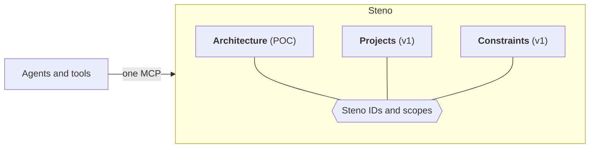

# The context layer

Where Steno goes after the POC: from the architecture to the organization's whole context, behind one MCP. A Decided direction (D141), designed and built in `v1`.

> **In one minute**
> - **Three pillars, as modules:** Architecture (what is; the POC), Projects (what's changing, why, and who), and Constraints (what must be respected).
> - They connect only through **Steno IDs and scopes**.
> - **Read-only to consumers.** Everything comes from where it already lives, or from onboarding.
> - **Architecture first.** The other pillars attach to its IDs, so their quality is capped by its accuracy.



## 1. Why one product

The pillars need the same machinery, and Steno has most of it: identity, scopes, connectors and the job queue, witnesses and claims, citations and completeness, and one MCP.

## 2. How the pillars connect

| Pillar | Relation to the hierarchy | Example |
|---|---|---|
| **Constraints** | **Attached** to a point in it | "Java 21 only" on the organization |
| **Projects** | **Overlaid** on it, touching many places | "Refunds v2" changed a topic, two flows, and a table |

A project reaches the architecture through its merged PRs:

```
Project → top-level ticket → epics → teams
                               ↓
                          merged PRs → changed lines → Steno IDs
```

- **Attribution falls out of the chain:** project → epic (team) → PR → the IDs it touched.
- Mapping changed lines to flows is why flows keep functions with **line ranges** (D140).
- **Open:** a PR merged at commit C must be mapped against the graph near C, not tonight's.

## 3. Projects (`v1`)

**Set up by a person:** create a project, link its issue tracker, and name its top-level ticket. **Ingested by Steno:** the epics, their teams, and merged PRs, mapped to Steno IDs.

It answers what a project changed, who changed it, why, what else is in flight here, and what happened last time.

## 4. Constraints (`v1`)

SLAs, approved technology, resource limits, compliance, and standards, each attached to a scope. Onboarding asks one set of questions (Open) and maps the answers onto what Steno offers.

## 5. What it enables

Asked about a PR that changes the refund contract, a review agent learns:

| From | It learns |
|---|---|
| **Architecture** | The consumers, the flows through it, what couldn't be seen |
| **Projects** | Another project changing a consumer; a lesson from last time |
| **Constraints** | The versioning standard; the flow's SLA |

## 6. Principles

- **One interface.** One MCP routes each question to the pillars it needs.
- **Modules linked only by Steno IDs.** No pillar reaches into another's storage.
- **Read-only to consumers.** The architecture is only derived from code and platform witnesses.
- **Cited, and honest about gaps.**
- **Works at any organization.**
- **Architecture first.**
