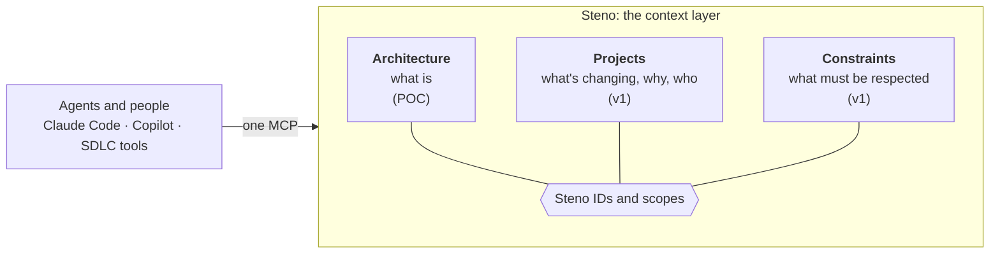

# The context layer

Where Steno is going after the POC: from the organization's architecture to its whole context, behind one MCP. Part of [Purpose](./README.md). Decided as a direction (D141); designed and built in `v1`. The POC builds only the Architecture pillar.

> **In one minute**
> - Steno becomes **the context layer** for an organization: one product, one MCP, answering everything an agent needs to know about the organization's software. Tools built on it (review agents, planning workflows, test generators: the agent-first SDLC) live in other repositories.
> - It has **three pillars, as modules:** **Architecture** (what is, from code; the POC), **Projects** (what's changing, why, and which team changed it), and **Constraints** (what must be respected: SLAs, approved technology, standards).
> - The pillars connect only through **Steno IDs and scopes.** Constraints *attach* to the hierarchy (organization → space → application → flow); a project *overlays* it, touching many spaces and applications at once.
> - **Read-only to consumers.** Everything is ingested from where it already lives (code, the issue tracker, merged PRs) or entered at onboarding. Agents read; they never write context. The architecture still comes only from code and platform witnesses.
> - **Sequencing:** get the Architecture pillar right and trial it at our organization first. Projects and Constraints follow in `v1`.



---

## 1. Why one product

The context a good change needs is scattered: the architecture lives in code across hundreds of repositories, projects live in tickets and PRs, and constraints live in wikis and people's heads. Every agent session rebuilds that picture partially, and differently each time.

The pillars need the same machinery, and Steno already has most of it:

| Shared machinery | Architecture uses it for | Projects and Constraints use it for |
|---|---|---|
| **Identity:** Steno IDs, canonical names, aliases (D81–D84) | Applications and everything under them | What a project changed; what a constraint governs |
| **Scopes:** organization, space, application | Rollups | Where a constraint attaches |
| **Connectors and the job queue** | Ingesting repositories nightly | Ingesting issue trackers and merged PRs |
| **Witnesses and claims** (D76, D114) | Comparing code with PLATFORM and DECLARED sources | Possibly: a project's intended changes compared with what its PRs did (Open) |
| **Citations, completeness, `sources`** | Every answer | Every answer |
| **One MCP** | Architecture tools | The same server, more tools |

## 2. How the pillars connect

The **hierarchy** is organization → space → application → flow, with interfaces and tables under applications. Every node in it has a permanent ID: an application's Steno ID, and child IDs built on it (D81–D84). Nothing else links by file path or by name.

| Pillar | Relation to the hierarchy | Example |
|---|---|---|
| **Constraints** | **Attached** to a point in it: most at the organization, some at a space or an application | "Refund flows answer within 300 ms" on the payments space; "Java 21 only" on the organization |
| **Projects** | **Overlaid** on it: one project touches many spaces and applications, so it sits beside the hierarchy, not in it | "Refunds v2" changed `order.created`, two flows in `refund-service`, and the `refunds` table |

**A project reaches the architecture through its merged PRs:**

```
Project ─▶ top-level ticket ─▶ epics ─▶ teams
                                  │
                                  ▼
                             merged PRs ─▶ repository + changed lines
                                                     │
                                                     ▼  modules (BUILT_FROM), function → flow lookup
                                         app:… · flow:… · interface:… · table:…
```

- A **repository is one source that two pillars read:** Architecture reads its code at a commit; Projects reads its merged PRs. A repository can hold several applications. The PR's changed lines say which application and which flows were touched, not the repository.
- **Attribution falls out of the chain:** "Team A added field X to `order.created` for Project Y" is project → epic (team) → PR → the Steno IDs it touched.
- This is why every flow keeps the functions it reaches with their **line ranges** (D140): mapping a PR's changed lines to flows uses them, as PR review and stack-trace lookup do.
- **Open (`v1`):** a PR merged at commit C must be mapped against the graph at or near C, not tonight's graph. IDs stay stable across commits; the lines they cover don't.

## 3. Projects (`v1`)

Projects carry forward the ideas behind Contextualized (none of its code), redesigned around the issue tracker and teams.

**Set up by a person, ingested by Steno:**

1. A person creates a project.
2. They link it to the organization's issue tracker (Jira, …).
3. They name the project's top-level ticket (in Jira, the "tetris ticket").
4. Steno finds the epics tied to that ticket, and the teams that own them, and associates those teams with the project.
5. Steno finds the repositories with merged PRs tied to the project.

**Each ingestion** follows the same path: project → top-level ticket → epics → merged PRs. It records the exact changes each PR introduced and maps them to Steno IDs, so every change is attributed to a team and a project.

**What it answers:**

| Question | Example |
|---|---|
| What did this project change? | "Refunds v2 added the audit write to the refund flow and a new `refund.issued` topic." |
| Who changed it? | "Team Ledger, in epic PAY-412." |
| Why? | The tickets and goals behind the change |
| What's in flight here? | Another project already changing a consumer of the contract you're about to change |
| What happened last time? | "The last change to this contract broke the ledger consumer; it needed a dual-write period." |

Q&A about a selected project and its diffs is served over the same MCP.

## 4. Constraints (`v1`)

What must be respected: SLAs, approved languages and frameworks, resource limits, compliance, and the organization's standards (contract versioning, conventions). Each attaches to a scope. **Onboarding** asks every organization one set of questions, with sub-questions (teams, users, spaces, providers, auth, resource limits, how commits are attributed), and maps the answers onto what Steno offers. The question set is designed with the pillar (Open).

## 5. What it enables

Each pillar adds to the same answer. Asked about a PR that changes the refund contract, a review agent gets:

| From | It learns |
|---|---|
| **Architecture** | The three services that consume the contract, the flows that run through it, and what Steno couldn't see |
| **Projects** | Another project already changing one of those consumers; a planned project that depends on the contract; a lesson from the last time it changed |
| **Constraints** | The organization's contract-versioning standard; the SLA on the refund flow |

That is the PR reviewer that keeps you from breaking anything by accident and keeps the change in line with the project's design and what's planned next. The same combination serves planning, testing, release (a safe deploy order), and operations (an error to its flow, its team, and its past incidents). The scenarios are collected in [use cases](./use-cases.md).

## 6. Principles

- **One interface.** Agents connect to one MCP endpoint, which routes each question to the pillars it needs and combines the answers.
- **Pillars are modules, linked only by Steno IDs.** Each stays coherent on its own; none reaches into another's storage.
- **Read-only to consumers.** Ingestion and onboarding are the only writers. The architecture is only ever derived from code and platform witnesses.
- **Cited, and honest about gaps.** Every claim says where it came from; every answer says what it couldn't see.
- **Works at any organization.** Nothing assumes one company's tools or structure.
- **Architecture first.** The other pillars attach to its IDs, so their quality is capped by its accuracy.
