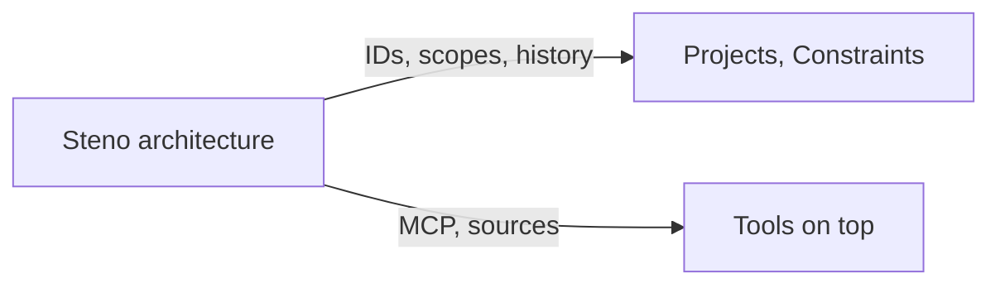

# Integration

What Steno provides to systems that build on it, and to its own Projects and Constraints pillars (`v1`, D141).

> **In one minute**
> - **Stable IDs** survive renames and moves.
> - **Planned IDs** come from natural keys, so a plan can name something before it exists.
> - **Change history**, **scopes**, and **MCP with citations** are the rest of the contract.
> - **The architecture must work without any of the other pillars.**

## 1. What Steno offers

| Offer | What it means | Status |
|---|---|---|
| **Stable IDs** | Everything is keyed on a permanent Steno ID (D81–D84) | Built |
| **Planned IDs** | `POST /v1/refunds` on an application can be referenced before it's built; the link becomes real when ingested | Follows from natural keys |
| **Scopes** | Organization, spaces, applications, for attaching rules or ownership | Built |
| **Change history** | Every run's added, removed, and changed facts (`fact_change`) | Built |
| **Commits → PRs** | A run's commit range mapped to PRs (`job_commit`) | `v1` |
| **Attribution hook** | `(:Project)-[:CHANGED {kind, pr, commit}]->(element)` | Designed, `v1` |
| **Read interface** | MCP tools with citations and completeness | Built |
| **Sources** | Repository, branch, commit, `head_moved`, cited folders, and why (D119) | Built |

## 2. Architecture and Projects (Decided, D11, D141)

| | Architecture | Projects |
|---|---|---|
| Knows | The system as it is | What each project changed and why |
| Built from | Code, re-derived nightly | Projects an organization registers |
| Answers | What does this do? What depends on it? | Which project introduced this? Why? |

The architecture owns *what* changed. Projects owns *why* and *who*, and never supplies structural facts.

## 3. Attribution (`v1`)

Each night, Steno records what changed and maps commits to PRs. The Projects pillar says which project a PR belongs to, and `CHANGED` edges are written. A project attaches **at the granularity of what it changed:** a whole flow it created, or only the change it made to an existing one.

## 4. Planning across projects

Conflicts between in-flight projects, protecting planned work, and planned-against-actual checks return with the Projects pillar (D97, D141).
