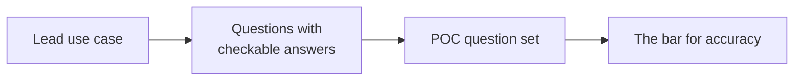

# Use cases

The questions Steno has to answer well. The POC's question sets are drawn from the five lead use cases.

> **In one minute**
> - **Lead use cases** (★) need only the graph, have no strong existing tool, and are easy to demonstrate.
> - **Scope test:** a feature belongs in Steno only if a use case needs it (D98, D141).
> - Tools that act on the answers are built on top, in other repositories.

**MCP tools today:** `search`, `get_node`, `get_flow`, `view_flow_code`, `find_dependents`, `route_request`. **Planned:** `analyze_change`, `get_interface`, `find_symbols`, `get_changes`, `find_paths`, `search_code`.

## Lead use cases in detail

### 1 ★ PR review with context

| | |
|---|---|
| **Asks** | Which flows run through the changed functions? Which interfaces change? Who consumes them? What's incomplete? |
| **Tools** | Today: `search`, `get_flow`, `find_dependents`. Planned: `analyze_change`. |
| **A correct answer has** | Every affected flow, changed interface, and downstream consumer, plus what Steno couldn't see |
| **Testable from** | Stage B |

### 2 ★ Breaking-change check in CI

"This PR changes the payload on `order.created`, which 3 services in 2 spaces consume."

| | |
|---|---|
| **Asks** | Does this alter a contract? Who depends on it? In what order should they deploy? |
| **Tools** | Today: `find_dependents`. Planned: `analyze_change`. |
| **A correct answer has** | The contract change, every consumer, those related PRs don't cover, a deploy order, and a completeness note |
| **Needs** | `USES_ENTITY` (not built) |
| **Testable from** | Stage B |

### 7 ★ "Grill me" planning

A lead describes work. An agent finds what it touches and asks what the plan hasn't answered.

| | |
|---|---|
| **Asks** | Which spaces and flows does this touch? What's downstream? Does it already exist? How many teams are involved? |
| **Tools** | `search`, `get_node`, `find_dependents` |
| **A correct answer has** | Touched flows and interfaces with consumers, spaces involved, similar capabilities, and explicit unknowns |
| **Testable from** | Stage A, stronger from B |

### 13 ★ Delta-driven testing

| | |
|---|---|
| **Asks** | What triggers this flow, and with what input? What does it read, write, and call? What changed? What's downstream? |
| **Tools** | Today: `get_flow`, `view_flow_code`, `find_dependents`. Planned: `get_interface`, `get_changes`. |
| **A correct answer has** | The trigger, its payload classes, pointers to validation and interceptor code, every effect, downstream flows, and the change |
| **Testable from** | Stage A (triggers, effects), B (contracts, interceptors) |

### 17 ★ From a stack trace to a flow

| | |
|---|---|
| **Asks** | Which flow does this frame belong to? What triggers it? Who calls it? What's affected? |
| **Tools** | Today: `search` on a function name, then `get_flow`, `find_dependents`. Planned: `find_symbols`. |
| **A correct answer has** | The flows whose traces hold the frames, their triggers, callers, and effects |
| **Testable from** | Stage A |

## The full catalog

Needs **Graph** unless noted. **Δ** = the delta store. **Schemas** = Data V2. **Projects** = the Projects pillar.

| # | Use case | What it enables |
|---|---|---|
| | **Agentic development** | |
| 1 ★ | PR review with context | A reviewer sees flows, consumers, and contract changes |
| 2 ★ | Breaking-change check | Warn or fail the build |
| 3 | Coordinated changes | Every consumer to update and the deploy order |
| 4 | Integration guides | "How do I call X?" from the interface and real callers |
| 5 | Guided onboarding | A walkthrough of a space |
| 6 | Feature implementation | Which services to integrate with, where similar code lives |
| | **Planning and design** | |
| 7 ★ | "Grill me" planning | Questions the plan hasn't answered |
| 8 | "Does this already exist?" | Search before building |
| 9 | Sizing and coordination | Flows, spaces, and teams touched |
| 10 | Where should this live? | Which space owns the concept |
| 11 | Deprecation planning | Who still calls this? |
| 12 | Decomposition planning | Coupling shows what can be extracted |
| | **Testing** | |
| 13 ★ | Delta-driven testing (Δ, Projects) | Before and after, and how to start the flow |
| 14 | What to regression-test | Walk downstream flows |
| 15 | Contract tests | Every producer and consumer pair is an edge |
| 16 | Test data setup (Schemas for columns) | Tables a flow reads and writes |
| | **Operations** | |
| 17 ★ | Stack trace to flow | A frame maps to its flow and callers |
| 18 | Blast radius | Who calls a failing service |
| 19 | Runbooks and replay | How to re-trigger a failed flow |
| 20 | Who owns this? (Ownership, `v2`) | Route an alert from the failing function |
| | **Security** | |
| 21 | CVE reachability | Does a flow reach the vulnerable function? |
| 22 | ACL drift (PLATFORM witness) | Grants against actual use |
| 23 | Third-party inventory | Every external system and the flows that call it |
| 24 | PII lineage (Schemas) | Which flows read a sensitive column |
| | **Architecture health** | |
| 25 | Governance checks | Direct database access across spaces, cycles, deep sync chains |
| 26 | Unused code | Endpoints with no callers |

## Scope boundary

Steno supplies grounded, current, attributable context. Test generators, CI bots, planning workflows, and incident copilots are built on top of it, in other repositories.

## Open questions

- **Access control:** how are scopes enforced on MCP results?
- **Showing confidence:** an inferred edge must never look as certain as a deterministic one.
