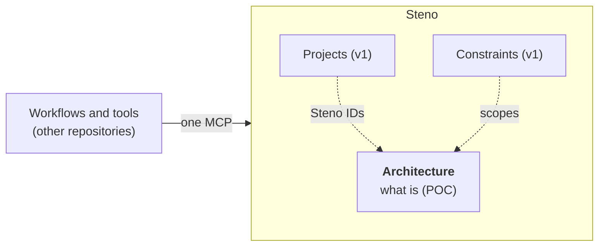

# Where Steno fits

What Steno owns, what it doesn't, and what it guarantees.

> **In one minute**
> - Steno answers *what is*. After the POC, Projects and Constraints join it behind one MCP (D141).
> - Tools that use the context live in other repositories.
> - **Steno is the breadth; agents are the depth.** Steno finds what's involved and points to the code. The agent reads and reasons.

## 1. Boundaries (Decided)

- **Read-only to consumers.** Only witnesses write: code, files about the system, other systems' data, admins. Agents never write context (D11, D75, D141).
- **Not a system of record.** It isn't a CMDB or catalog. It reads those and checks them against the code (D96).
- **Passive.** It never asks an organization to change its repositories.
- **Not Steno's job:** the tools built on top, or the harness that manages workspaces for agents.

## 2. Guarantees

| Guarantee | How |
|---|---|
| **Same question, same answer** | Deterministic rules, facts computed once at ingestion |
| **Complete, or says what's missing** | Witness agreement, completeness signals |
| **Every claim cited** | Citations on every MCP result |
| **Current** | Nightly runs for repositories whose main branch moved |
| **Works at any organization** | Fixed facets, swappable witnesses, shared packs |

## 3. Why not give an agent every repository?

| Question type | Agent with every repository | Steno |
|---|---|---|
| The name appears literally | Works | Works |
| The connection isn't text (`${app.topics.orders}`, a Feign client) | Unreliable, redone each session | Resolved at ingestion |
| Several hops ("what breaks downstream?") | Dozens of investigations | One call |
| A concept with no name | Thousands of hits | Routing over flow digests |
| "Every consumer of this" | Can't know when it's done | Says what it couldn't see |

Answers also vary between sessions, discovery is re-paid each time, and every machine needs every repository. The POC measures this directly.

## 4. Breadth and depth (Decided, D119, D136)

**Compute deep, store the surface, point to the body.** The line is an application's edge, not a repository's: a table only one application uses still counts, because the database is outside the process.

| Layer | What Steno keeps |
|---|---|
| **Placement** | Organization → space → application → repository and module; names |
| **Surface** | Every way in (endpoints, consumed topics, schedules) and out (calls, publishes, tables, files, external systems) |
| **Reach** | Per flow: trigger, effects, functions with lines |
| **Search text** | The names of all of these, plus digests and summaries |
| **Pointers** | File, lines, commit, `sources` |

**The agent's:** internal call order, branching, validation rules, what a function computes, and how an interceptor works.

**When it matters:** a change that touches an application's surface, or an agent invoking a flow. A purely internal refactor gets little from Steno and should cost nothing to skip.

| | Steno | The agent |
|---|---|---|
| Does | Finds what's involved; says what it couldn't see | Reads, reasons, plans, edits, tests |
| Code | Serves it from the git host at the ingested commit | Clones only what a task needs |
| Never | Runs an agent to answer | Searches every repository to find which few matter |

Cloning was never the problem; not knowing *which* repositories to clone was. Every answer lists its `sources`, so a consumer fetches exactly those. Details: [Retrieval §4](../how-it-works/retrieval-and-mcp.md#4-code-access-and-breadth-decided-d17-d119).
