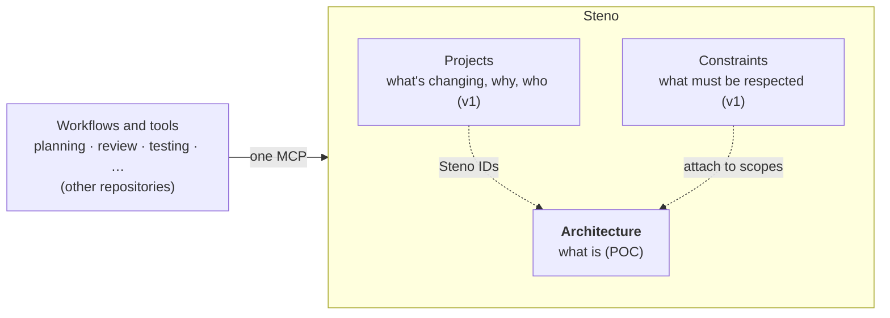

# Where Steno fits

What Steno owns, what it deliberately doesn't, and the guarantees it makes to the people and systems that rely on it. Part of [Purpose](./README.md).

> **In one minute**
> - Steno answers *what is*: the architecture, from code. That's the POC. After it, Steno becomes **the context layer** (D141): Projects (*what's changing, why, and who*) and Constraints (*what must be respected*) join as pillars, linked by Steno IDs, behind the same MCP. See [the context layer](./context-layer.md).
> - The workflows that use the context (review agents, planning, test generators: the agent-first SDLC) are built on top, in other repositories.
> - Steno guarantees: the same answer to the same question, complete or says what's missing, every claim cited, current, and works at any organization.
> - **Steno is the breadth; agents are the depth.** Steno maps the whole organization and points to the exact code; Claude Code or Copilot reasons over it, and clones only the few repositories a task needs.

---

## 1. From the architecture to the context layer

In the POC, Steno answers **what is**: what exists, how it communicates, what each flow does, and what a change affects. After the POC it becomes the organization's **context layer** (D141, revising D98): Projects and Constraints join as pillars, modules linked only through Steno IDs and scopes, served by the same MCP. The vision, and how the pillars connect, is in [the context layer](./context-layer.md). What Steno offers systems built on it is in [Integration](./integration.md).

The POC builds and proves the Architecture pillar alone, through a trial at our organization; the other pillars attach to its IDs, so their quality is capped by its accuracy.

## 2. Boundaries (Decided)

- **Read-only to consumers.** Only witnesses write to Steno: code, files about the system, other systems' data (later: issue trackers and merged PRs for Projects), and admins and onboarding. Agents and workflows read; they never write context. After a merge, Steno works the architecture out again from the code (D11, D75, D141).
- **Steno is not a system of record.** It isn't a CMDB or a service catalog. It reads those where an organization has them and checks them against the code (D96).
- **Steno never asks an organization to change its repositories.** It reads what's already there.
- **Not Steno's job:** the tools and workflows built on top (review bots, test generators, planning workflows, incident copilots), and the harness that clones and manages workspaces for agents. Constraints, standards, and projects become Steno pillars in `v1` (D141); until then they're out of scope.

## 3. Guarantees

| # | Guarantee | How |
|---|---|---|
| 1 | **Same question, same answer.** Two people asking "who consumes `payment.settled`?" get the same result. | Deterministic rules; facts computed once at ingestion |
| 2 | **Complete, or says what's missing.** An impact answer that silently leaves out a consumer is worse than no answer. | [Trust](../concepts/trust.md): agreement between witnesses, completeness signals, gaps never silent |
| 3 | **Every claim cited** to a file, line, and commit, or to the system it came from. | Citations on every MCP result |
| 4 | **Current.** | Nightly runs for every repository whose main branch moved |
| 5 | **Works at any organization** without rebuilding Steno. | Fixed [facets](../concepts/witnesses-and-facets.md), swappable witnesses, shared rule packs |

## 4. Why not just give an agent every repository?

An agent with every repository cloned and good search does well when a name appears literally in the code. It breaks down on exactly the questions planning and impact analysis need:

| Question type | Example | Agent with every repository | Steno |
|---|---|---|---|
| The name appears literally | "Who uses `order.created`?" (a string in code) | Works | Works |
| The connection isn't written as text | Topic from `${app.topics.orders}`; URL from an env var plus a constant; a Feign client | Unreliable; redone every session | Resolved once at ingestion |
| Several hops | "What breaks downstream if I change this?" | Breaks: dozens of investigations per question, context fills up | One call: `find_dependents` |
| A concept, no name | "How does a client get created?" | Breaks as the organization grows: thousands of hits | Flow cards + verification (later); flow and trace names today |
| Must be complete | "Every consumer of this" | Can't know when it's found everything | Says what it couldn't see |

Plus three costs regardless of question type: answers differ between sessions, every session re-pays the discovery, and every developer machine needs every repository and credentials for all of them. The POC measures this directly: the same questions, with and without Steno ([roadmap](../plan/roadmap.md#4-evaluation)).

## 5. Breadth and depth (Decided, D119)

Steno doesn't replace what agents are good at. It does what they can't do cheaply: know the whole organization.

**Where the line is (D136): compute deep, store the surface, point to the body.** The line is an *application's* edge, not a repository's: anything that crosses the process boundary is Steno's (a table only one application uses still counts, because the database is outside the process). Ingestion may analyze as deeply as it needs; what Steno stores and serves stops at five layers:

| Layer | What Steno keeps | Why the agent can't get it alone |
|---|---|---|
| **Placement** | Organization → space → application → repository and module; deployed names; aliases | It can't find the right space or application without it |
| **Surface** | Every way in (endpoints, consumed topics, schedules) and out (calls, publishes, table reads and writes, files, external systems), named, with a pointer to the payload class | Joins, blast radius, and "who touches X" depend on it |
| **Reach** | For each flow: trigger, effects reached, functions reached with lines | Picking the right flow; function → flow; stack trace → flow |
| **Search text** | The names of all of the above, and flow purposes | Routing a vague question to the right place |
| **Pointers** | File, lines, commit; the `sources` block | Handing off to the agent |

The order of internal calls, branching, validation rules, what a function computes, and how an interceptor works are **the agent's**: it reads them from the code Steno points to.

**When Steno matters:** when a change touches an application's surface, or when an agent needs to invoke a flow (an end-to-end test needs its trigger, payload, and downstream effects). Most developers work in one or two repositories; their agent already sees those deeply. Steno gives it the other end of every edge: who consumes the event, what service a URL is, which route a request came through, what else writes the table. A purely internal refactor gets little from Steno, and it should cost nothing to skip.

| | Steno (breadth) | The agent (depth) |
|---|---|---|
| Does | Finds what's involved across the organization: applications, flows, consumers, contracts, interceptors; says what it couldn't see | Reads the code Steno points to, reasons about it, plans, edits, runs tests |
| Code | Serves it from the git host at the ingested commit, with exact pointers | Clones only the repositories a task needs, when it needs a working copy |
| Never | Runs an agent to answer a question; manages workspaces | Has to search every repository to find which few matter |

Cloning was never the problem; not knowing *which* repositories to clone was. Every Steno answer lists its `sources` (repository, commit, paths, why), so the consumer, or the harness it runs in, fetches exactly those. That harness belongs to the SDLC tools built on top, not to Steno; for a developer working locally, Steno's investigation plugin does the sparse clone (D133). Details: [Retrieval §4](../how-it-works/retrieval-and-mcp.md#breadth-and-depth-decided-d119).
