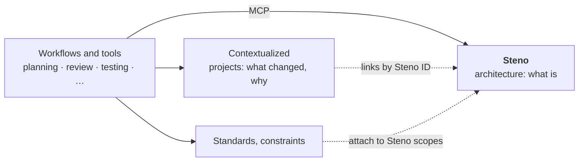

# Where Steno fits

What Steno owns, what it deliberately doesn't, and the guarantees it makes to the people and systems that rely on it. Part of [Purpose](./README.md).

> **In one minute**
> - Steno is **one piece of a larger picture**: it answers *what is* (the architecture, from code). Project history (*what changed and why*), standards and constraints (*what should be*), and the workflows that use all of it are separate systems that link to Steno by ID.
> - That larger picture (a "context layer" for an agent-first SDLC) is designed in **its own project**, not here (D98). Steno documents only its own scope and the contract it offers.
> - Steno guarantees: the same answer to the same question, complete or says what's missing, every claim cited, current, and works at any organization.
> - **Steno is the breadth; agents are the depth.** Steno maps the whole organization and points to the exact code; Claude Code or Copilot reasons over it, and clones only the few repositories a task needs.

---

## 1. One piece of a larger picture

Steno answers **what is**: what exists, how it communicates, what each flow does, and what a change affects. Other systems answer other questions and connect to Steno through its stable IDs and scopes (the organization, a space, an application). What Steno offers them is in [Integration](./integration.md).

How those pieces combine into an agent-first SDLC (planning, implementation, testing, release, monitoring, each pulling context and writing back) is designed in a separate project (D98). Steno stays useful on its own: an organization can adopt it without adopting anything else.

## 2. Boundaries (Decided)

- **Only witnesses write to Steno:** code, files about the system, other systems' data, and admins. Workflows that use Steno record their own work elsewhere and link by ID. After a merge, Steno works the architecture out again from the code (D11, D75).
- **Steno is not a system of record.** It isn't a CMDB or a service catalog. It reads those where an organization has them and checks them against the code (D96).
- **Steno never asks an organization to change its repositories.** It reads what's already there.
- **Not Steno's job:** standards, constraints, SLAs, test conventions, ADRs, project plans, and the tools and workflows built on top (review bots, test generators, planning workflows, incident copilots).

## 3. Guarantees

| # | Guarantee | How |
|---|---|---|
| 1 | **Same question, same answer.** Two people asking "who consumes `payment.settled`?" get the same result. | Deterministic rules; facts computed once at ingestion |
| 2 | **Complete, or says what's missing.** An impact answer that silently leaves out a consumer is worse than no answer. | [Trust](../concepts/trust.md): agreement between witnesses, completeness signals, gaps never silent |
| 3 | **Every claim cited** to a file, line, and commit, or to the system it came from. | Citations on every MCP result |
| 4 | **Current.** | Nightly runs for every repository whose main branch moved |
| 5 | **Works at any organization** without rebuilding Steno. | Fixed [facets](../concepts/witnesses-and-facets.md), swappable witnesses, shared rule packs |

## 4. Why not just give an agent every repository?

An agent with every repository cloned and good search does well when a name appears literally in the code. It breaks down on exactly the questions planning and impact analysis need:

| Question type | Example | Agent with every repository | Steno |
|---|---|---|---|
| The name appears literally | "Who uses `order.created`?" (a string in code) | Works | Works |
| The connection isn't written as text | Topic from `${app.topics.orders}`; URL from an env var plus a constant; a Feign client | Unreliable; redone every session | Resolved once at ingestion |
| Several hops | "What breaks downstream if I change this?" | Breaks: dozens of investigations per question, context fills up | One call: `find_dependents` |
| A concept, no name | "How does a client get created?" | Breaks as the organization grows: thousands of hits | Flow cards + verification (later); flow and trace names today |
| Must be complete | "Every consumer of this" | Can't know when it's found everything | Says what it couldn't see |

Plus three costs regardless of question type: answers differ between sessions, every session re-pays the discovery, and every developer machine needs every repository and credentials for all of them. The POC measures this directly: the same questions, with and without Steno ([roadmap](../plan/roadmap.md#4-evaluation)).

## 5. Breadth and depth (Decided, D119)

Steno doesn't replace what agents are good at. It does what they can't do cheaply: know the whole organization.

| | Steno (breadth) | The agent (depth) |
|---|---|---|
| Does | Finds what's involved across the organization: applications, flows, consumers, contracts, interceptors; says what it couldn't see | Reads the code Steno points to, reasons about it, plans, edits, runs tests |
| Code | Serves it from the git host at the ingested commit, with exact pointers | Clones only the repositories a task needs, when it needs a working copy |
| Never | Runs an agent to answer a question; manages workspaces | Has to search every repository to find which few matter |

Cloning was never the problem; not knowing *which* repositories to clone was. Every Steno answer lists its `sources` (repository, commit, paths, why), so the consumer, or the harness it runs in, fetches exactly those. That harness belongs to the SDLC layer (D98). Details: [Retrieval §4](../how-it-works/retrieval-and-mcp.md#breadth-and-depth-decided-d119).
