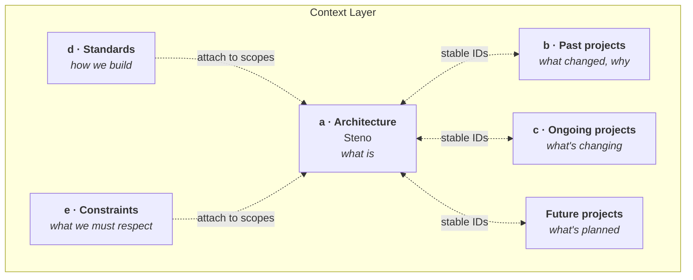

# Vision

Why Steno exists, and where it fits in a bigger picture: a **Context Layer** that an agent-first software development lifecycle pulls from at every phase.

> **In one minute**
> - Agents can't make good changes in a large organization without knowing what's around the code they touch. Today that knowledge lives in people's heads and stale docs.
> - The **Context Layer** gathers it in one place: the organization's architecture, its past, ongoing, and future projects, and its standards and constraints.
> - **Steno is the architecture pillar.** It derives *what is* from the code and keeps it current, with citations and an honest account of what it couldn't see.
> - **Contextualized** supplies *what changed and why*, project by project. Together they let an agent see both the landscape and the work moving through it.

## Pages

| Page | What it covers |
|---|---|
| [The Context Layer](./context-layer.md) | The agent-first SDLC, the pillars, what each phase needs, and what Steno owns and doesn't |
| [Projects: past, ongoing, future](./projects.md) | How Steno and Contextualized work together: keeping the architecture attributed, spotting conflicts between in-flight projects, protecting planned work, ordering bodies of work |
| [Use cases](./use-cases.md) | What an organization gets: agentic development, planning, testing, operations, security, architecture health |

## The thesis

Agents are highly capable within one repository and largely blind beyond it. That blindness caps what agent-first development can do, however good the model gets. Steno turns a repository-scoped agent into an organization-scoped one, by making "what exists, how it fits together, and what a change touches" something you can **query** instead of something you have to know.

The payoff grows with the organization: one engineer with an agent can work at organization scale, changing things across services and spaces while keeping the patterns that have been in place for years, because the agent can see the whole organization.
