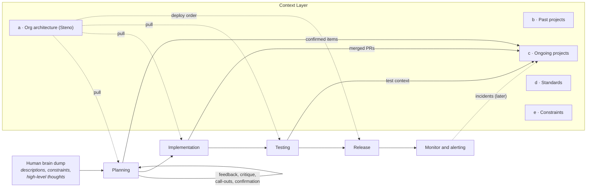

# The Context Layer

The long-term picture Steno is built for: an **agent-first software development lifecycle** in which every phase pulls the context it needs from one shared layer, and writes back what it learns.

> **In one minute**
> - Each SDLC phase asks questions only the wider organization can answer: what a change touches, who depends on it, how to trigger and test a flow, what order to ship in.
> - The **Context Layer** answers them from five pillars: (a) architecture, (b) past projects, (c) ongoing projects, (d) standards, (e) constraints. Future projects sit alongside ongoing ones.
> - **Steno is pillar (a).** It must give the same answer to the same question, be complete or say what it's missing, cite every claim, stay current, and work at any organization.
> - Phases write to the **project pillars**, never to Steno directly. Steno re-derives the architecture from code after every merge.

---

## 1. The lifecycle

A person starts with a brain dump: what they want, the constraints they know, rough ideas. Planning turns it into a plan through a loop of agent critique and human confirmation. Implementation, testing, release, and monitoring follow. **Every phase pulls context, and planning, implementation, and testing write back** what they confirmed, merged, or learned.

## 2. What each phase asks

| Phase | Questions | Answered from |
|---|---|---|
| **Planning** | Which spaces and services will this touch? What's downstream? Which flows change, which are new? How should the work be broken down, and in what order? Who needs to be involved? Does this collide with work already in flight? | Steno (flows, dependents, impact), ongoing and future projects, constraints |
| **Implementation** | Where exactly do I change the code? If I change this, what else must change? Does something like this already exist? What conventions does this space follow? | Steno (flows, traces, code), standards |
| **Testing** | What triggers this flow, and with what input? What does it read and write? What's downstream to regression-test? How does this team test things like this? | Steno (triggers, entities, effects, downstream flows), standards (test conventions) |
| **Release** | In what order do producer and consumers deploy? | Steno (`analyze_change`) |
| **Monitoring** | Which flow does this stack trace belong to? Who calls the failing service? | Steno (`find_symbols`, dependents); incidents written back later |

## 3. The pillars

| Pillar | Holds | Owned by | Status |
|---|---|---|---|
| **(a) Architecture** | What exists, how it communicates, what each flow does, what a change affects | **Steno** | POC |
| **(b) Past projects** | What each project changed and why: diffs, tickets, summaries | Contextualized | Exists; integration later |
| **(c) Ongoing projects** | What in-flight projects plan to touch and have touched | Contextualized (extended) | Later |
| **Future projects** | What's planned, and what it depends on | Contextualized (extended) | Later |
| **(d) Standards** | How the organization builds: frameworks, conventions, test practices | A standards pillar (for example, a catalog's scorecards) | Later |
| **(e) Constraints** | What must be respected: approved languages, resource limits, SLAs | A constraints pillar | Later |

**Steno answers *what is*.** Projects answer *what changed and why* and *what's coming*. Standards and constraints answer *what should be*. "Runs on three servers with 4 GB each" is a fact (Steno, later). "Must run in under 2 GB" is a constraint (pillar e). The pillars connect through **Steno's stable IDs** and **scopes** (the organization, a space, an application): a constraint attaches to a space, and a project attaches to the flows it changed. An agent asking about an application gets the facts and the rules that apply to it together. See [Projects](./projects.md) for how the project pillars connect.

## 4. What Steno must guarantee

| # | Guarantee | How |
|---|---|---|
| 1 | **Same question, same answer.** Engineer X and engineer Y asking "who consumes `payment.settled`?" get the same result. | Deterministic rules; facts computed once at ingestion, not re-derived per question |
| 2 | **Complete, or says what's missing.** An impact answer that silently leaves out a consumer is worse than no answer. | [Trust](../concepts/trust.md): agreement between witnesses, completeness signals, gaps never silent |
| 3 | **Every claim cited** to a file, line, and commit, or to the system it came from. | Citations on every MCP result |
| 4 | **Current.** | Nightly runs for every repository whose main branch moved |
| 5 | **Works at any organization** without rebuilding Steno. | Fixed [facets](../concepts/witnesses-and-facets.md), swappable providers, shared rule packs |

## 5. Boundaries

- **Only providers write to Steno:** code, files about the system, other systems' data, and admins. The SDLC phases write to the project pillars and link to Steno by ID. After a merge, Steno re-derives the architecture from the code (D11). This keeps the pillar deterministic and rebuildable. **Decided**
- **Steno is not a system of record.** It isn't a CMDB or a service catalog. It reads those, where an organization has them, and checks them against the code. Its own products are flows, joins across services, and agreement between sources. **Decided**
- **Steno never asks an organization to change its repositories.** It reads what's already there. **Decided**
- **Not Steno's job:** constraints, SLAs, standards, test conventions, ADRs, project plans. They live in other pillars and attach to Steno's scopes by ID. **Decided**
- **Steno doesn't build the tools that use the context** (test generators, CI bots, planning workflows, incident copilots). Agents and workflows build those on top. See [Use cases → Scope boundary](./use-cases.md#scope-boundary).

## 6. Why the architecture pillar comes first

Planning, implementation, and testing all start from the same questions about the landscape: what exists, how it connects, what a change touches. Every other pillar attaches to the architecture's IDs: a project to the flows it changed, a constraint to the space it governs. Getting this pillar right makes everything built on top simpler, so it's where the effort goes first.

### Why not just give an agent every repository?

An agent with every repository cloned and good search does well when a name appears literally in the code. It breaks down on exactly the questions planning and impact analysis need:

| Question type | Example | Agent with every repo | Steno |
|---|---|---|---|
| The name appears literally | "Who uses `order.created`?" (string in code) | Works | Works |
| The connection isn't written as text | Topic from `${app.topics.orders}`; URL from an env var plus a constant; a Feign client | Unreliable; redone every session | Resolved once at ingestion |
| Several hops | "What breaks downstream if I change this?" | Breaks: dozens of investigations per question, context fills up | One call: `find_dependents` |
| A concept, no name | "How does a client get created?" | Breaks as the org grows: thousands of hits | Flow cards + verification |
| Must be complete | "Every consumer of this" | Can't know when it's found everything | Says what it couldn't see |

Plus three costs regardless of question type: answers differ between sessions, every session re-pays the discovery, and every developer machine needs every repository and credentials for all of them. The POC measures this directly (see [Roadmap](../plan/roadmap.md)): the same questions, with and without Steno.
