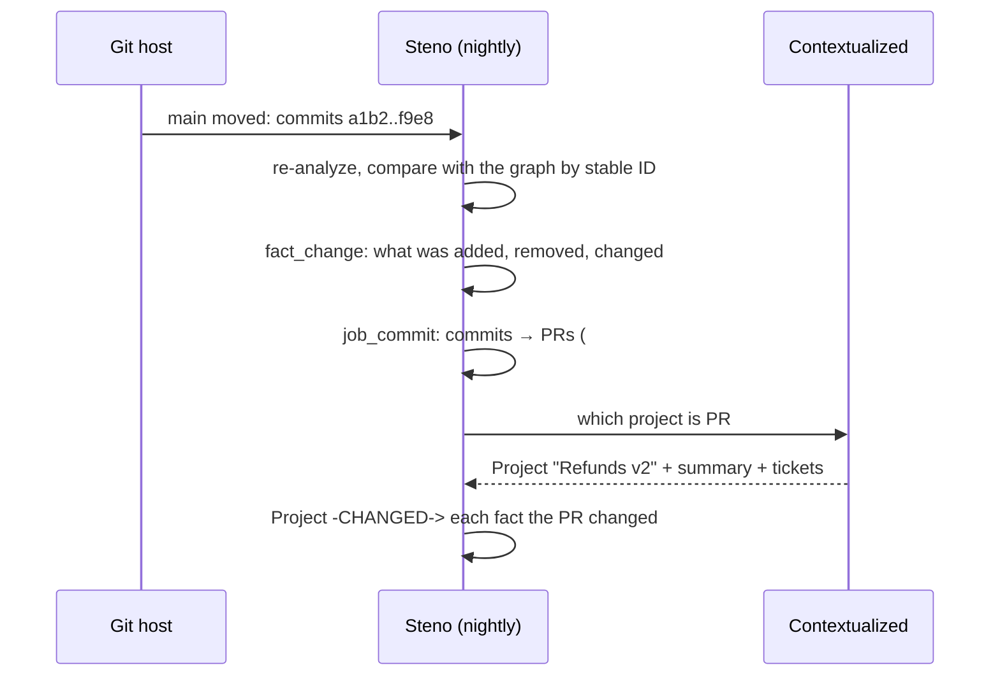
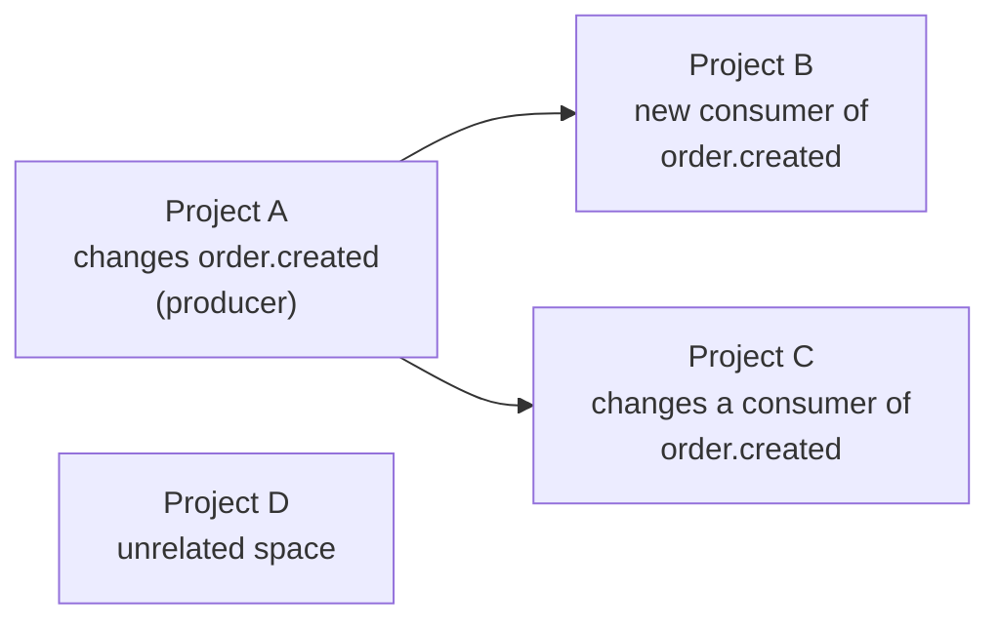

# Projects: past, ongoing, future

How Steno (the architecture) and [Contextualized](https://github.com/KBavis/contextualized) (the projects) work together, so an agent sees both the landscape and the work moving through it.

> **In one minute**
> - Steno knows **what is**: the architecture now, derived from code. Contextualized knows **what changed and why**: each project's diffs, tickets, and summary.
> - They connect through **Steno's stable IDs**. A project links to the flows, interfaces, and applications it changed or plans to change.
> - That gives four things no single tool gives today: an **attributed history** of the architecture, **conflict detection** between in-flight projects, **protection for planned work**, and a sensible **order for bodies of work**.
> - **Steno must work without Contextualized.** The integration is the goal, not a dependency.
>
> Status: everything on this page is **Proposed** unless marked, scope **v1/v2**. What it needs from Steno (stable IDs, planned IDs, change history) is built in the POC.

---

## 1. Two halves of one picture

| | Steno | Contextualized |
|---|---|---|
| Knows | The architecture as it is: applications, interfaces, flows, tables, who depends on what | What each project changed and why: its PRs, diffs, tickets, summary |
| Built from | Code (and later, the systems around it), re-derived nightly | Projects an organization registers |
| Answers | "What does this flow do? What depends on it? What does this change touch?" | "Which project introduced this? Why?" |
| Unit | A fact with a stable ID | A project and its changes |

**Division of work (Decided, D11):** Steno owns *what* changed, as deterministic facts and deltas, and owns re-ingestion. Contextualized owns *why*: the project, the tickets, the intent. Contextualized never supplies structural facts.

## 2. Keeping the architecture attributed

Every change to a flow, interface, or application then carries "changed by Project A, because …". Projects attach **at the granularity of what they changed**, never assumed to explain a whole flow:

- **A flow a project created:** that project's context explains the whole flow.
- **An existing flow a project changed:** the context is scoped to the change, e.g. "Refunds v2 added the audit write at step 1.2." A PR that only refactored internals is found by matching its changed files and lines against flow traces.
- **Flows no project touched** keep their code-derived purpose.

The graph side: `(:Project {id, name, summary})-[:CHANGED {kind: added|modified|removed, pr, commit}]->(element)`, where `element` is a Flow, Step, Interface, Table, or rollup target. See [graph reference: business context](../how-it-works/graph-reference.md#business-context-from-contextualized-later).

## 3. Ongoing projects

In the Planning phase, a project records **what it plans to touch**, as Steno IDs. Because Steno's IDs come from natural keys, a plan can name something that doesn't exist yet ("we'll add `POST /v1/refunds` to Billing"). That link becomes real when the code lands, the same way stubs merge today. See [Identity](../concepts/identity.md).

With planned touches recorded, Steno can:

| Capability | Example |
|---|---|
| **Spot conflicts** | Two in-flight projects both change the `user.created` contract. Planning raises it before either ships. |
| **Warn about in-flight work** | An answer about a flow says "this flow is being changed by Project B (in progress)", so an agent doesn't build on something about to move. |

## 4. Future projects

| Capability | Example |
|---|---|
| **Protect what's planned** | A change that would break an interface a planned project depends on is flagged: "Project F is planned on this contract." |
| **Order the work** | Projects whose changes sit upstream (a producer's contract) go before the projects that depend on them. The order comes from the graph's edges plus each project's planned touches. Deploy order *within* one change still comes from `analyze_change`. |

## 5. Planned vs. actual

After a project's PRs merge, Steno's recorded changes are compared with the plan: "the plan said flows A and B; the merged change touched A, B, and C." That closes the loop between Planning and what actually shipped, and it's the raw material for better estimates next time.

## 6. Boundaries

- **Steno doesn't store projects or plans.** It provides stable IDs, planned IDs, change history, and impact analysis. The project pillars store plans and link to Steno.
- **Steno must work without Contextualized** (Decided). Everything above degrades gracefully: without it, changes are attributed to PRs but not projects.

## 7. What this needs from Steno, and when

| Need | Status | Scope |
|---|---|---|
| Stable IDs that survive renames and moves | Designed: [Identity](../concepts/identity.md) | `POC` stage A |
| Planned IDs (link to something not built yet) | Follows from natural keys | `POC` stage A |
| Change history per run (`fact_change`) | Built | `POC` |
| Commits mapped to PRs (`job_commit`) | Not built | `v1` |
| The Contextualized integration (PR → project, `CHANGED` edges) | Not built | `v1`/`v2`, to decide |
| Ongoing/future project registry, conflict and ordering checks | Not designed | `v2` |
